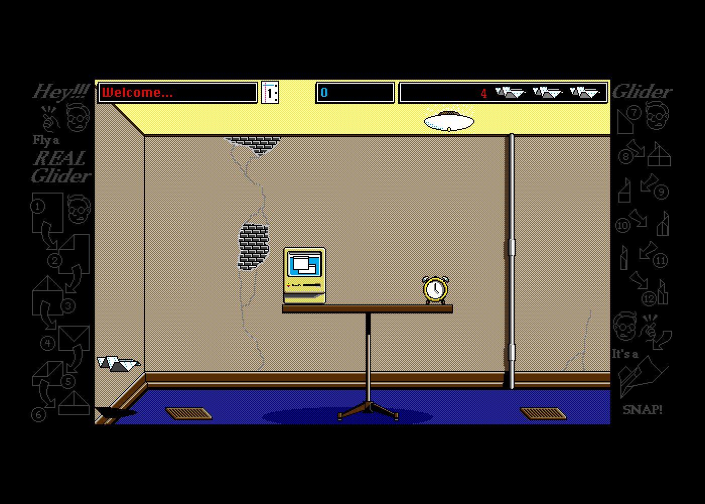

# Glider 4.0 Unofficial Web Edition

John Calhoun's 1991 Macintosh game, ported line by line from its Pascal source to TypeScript, to run in the browser.

**[Play it](https://dbohdan.github.io/glider/)**



## What it is

It is the original game, Glider 4.05, with its houses, art and sounds, playing in the browser as it played on a Mac in 1991: the same rooms, the same timing, the same bugs.

Two things run in the page, both written in TypeScript.
One is Glider itself, translated from Calhoun's Pascal source unit by unit, keeping its procedures, variables and control flow.
The other is the part of the Mac's system software that Glider calls, the Toolbox of System 6 (QuickDraw and Color QuickDraw for drawing, the Window, Menu, Control and Dialog Managers, TextEdit, Standard File, and SMS, the sound library Glider links), written anew from what the real one does.

What it is not:

- **An emulator.** No Mac ROM or System software runs in the page or ships with it. An emulator is used only in testing, as the [oracle](#the-oracle).
- **A remake.** Glider's timing and its bugs are kept on purpose.
- **Glider PRO.** That is Calhoun's later game.
- **Official.** It is not made or endorsed by John Calhoun or Casady & Greene. Calhoun's company, softdorothy, released the source in 2016 under the MIT License, which allows ports like this one.

## Playing

You need a keyboard (or a mouse, once you switch Glider to mouse steering); phones and tablets are not supported yet.
The page starts on a Mac II in 16 colors; Options > Display & Keyboard, Scale and Art change that (see [Additions](#additions)).

The keys Glider comes with (⌘ is Command on a Mac and Control elsewhere):

| Key | Does |
|---|---|
| ← and → | fly left and right |
| ↓ | battery boost, when you have a battery |
| ↑ | fire a rubber band, when you have bands |
| Tab | pause; Tab again resumes |
| ⌘S, ⌘E, ⌘Q | save the game, end it, quit |

Configure… in the Options menu changes the keys or switches to the mouse, and Glider's own Help screens (also in the Options menu) explain the rest.
While Glider steers by the mouse, a click on the screen captures the pointer, and Escape releases it.

Quitting Glider goes to the desktop, a System 6 Finder with three icons: Glider, the Room Editor (still being checked against the original), and the source code.
Its menus are where the browser's own operations live:

- **File > Import Files…** puts houses, art and saved games on the port's disk, beside the houses that come with it: MacBinary, AppleSingle, StuffIt, Compact Pro, disk images (DiskCopy 4.2 or bare HFS), and ZIP archives of them.
- **File > Export Files…** saves your saved games, houses, high scores and preferences as a ZIP archive, which Import reads back.
- **Special > Reset Preferences and Scores…** puts back Glider's preferences and the high scores of the houses that came with it.

What you change is kept in the browser's storage, so Export Files… is your backup.


## Additions

What the port adds to Glider, in Glider's own style and built from its own parts, and what it changes:

- **Options > Display & Keyboard:** a black-and-white Mac Plus (512×342) with its own keyboard, a Mac II in 16 colors or in black and white (640×480), or the Mac II's screen as Glider for Windows (1994) drew it, in its colors and with its dithered fills, with a 16-color or a 256-color driver. Another Mac starts the program again through its own Quit; the Mac II's color screen and the Windows looks change into one another at once.
- **Options > Scale:** whole screen pixels per Mac pixel, the largest that fits the window by default; sizes that do not fit are dimmed.
- **Options > Art:** the art files on the disk, the original's and any you import; the other kind (color or black and white) is dimmed. Glider and the Room Editor each open their art as they start, so a choice starts the program again.
- **The same Options on the desktop and in the Room Editor:** Display & Keyboard and Scale on the desktop, and Art as well in the editor, in an Options menu after their own.
- **Bass Beat**, in Sound Settings under Music On, as Glider for Windows has it: off, it silences the bass during play and keeps the jingle on entering a room. It is on unless turned off, as the Mac plays the bass.
- **Sound Settings remembers 4-Channel.** Glider 4.05 saves the choice but, as it starts, writes over it instead of reading it, so on a Mac it always started in 2-Channel.
- **Preferences for each Mac:** the Mac Plus and the Mac II each keep their own copy of Glider's preferences, as each Mac on a 1991 desk had its own copy of Glider. Houses and saved games are shared.
- **The desktop** in place of the Finder, with the browser's own operations in its menus (see [Playing](#playing)).
- **The address:** `?startup=desktop` starts on the desktop, `?machine=plus` (or `ii`, `ii-bw`, `win-16`, `win-256`) chooses the machine, and `?scale=2` the scale. The browser remembers the machine and the scale you choose in the menus.
- **The mouse:** while Glider steers by the mouse, a click on the screen captures the pointer, so that the game can move the Mac's mouse as it does on a Mac, and Escape releases it.

Small changes:

- The About box names the port: "Glider 4.0 Unofficial Web Edition, a port of Glider 4.0 by John Calhoun". The dialog is taller to fit it.
- The Apple menu's title is a diamond, not Apple's logo.
- The watch cursor the Room Editor shows as it starts is the port's own drawing; the Mac kept its watch in ROM.
- The browser's Mac II has an Apple Extended Keyboard, the keyboard Glider 4.05's preferences were saved with, so the arrow keys work from the start.

## Known bugs and quirks

The port keeps the original's bugs, so that it plays as the original did. These are the ones you are likely to meet:

- **Try Glider leaves a trail.** In the Room Editor, the glider leaves a copy of itself on every frame until the flight ends, and on a black-and-white screen its shadow smears along the floor. The editor's flight code puts the glider on the screen and never puts the background back. Its source is a copy of Glider's play code with the erasing left out, so it may be on purpose: the trail shows the flight path, which is what a house's author tunes. Calhoun fixed a "glide ratio" bug in Try Glider for 1.03, where the glider flew farther than in the game, and a trail would show just that.
- **"New keyboard" on the Mac Plus.** The first time Glider starts on the Mac Plus it says "New keyboard. Switching to default keyboard controls." and steers with comma and period, Return and space. Its preferences were saved with another keyboard; Configure… sets the keys again.
- **Art from other releases looks wrong.** Glider 4.05 moved its sprites to new places in the art file, so art files from 4.02 and 4.04 ("Art 16" and "Art 2") show the wrong pieces of the sprites. The black-and-white art of 4.06 and later has the switches a little narrower.
- **Locked houses stay locked.** The Room Editor will not open a locked house, and locking one in House Info… cannot be undone. The House and most of the other houses that come with the port are locked; The House (July 1991), Calhoun's working copy, is not, and you can open it to see how a house is made.
- **Hands-off House dies at Shockproof!.** Ward Hartenstein's house plays itself, and the port flies it as the original does on a fast Mac: through twelve rooms, then fried by the outlets of room 13 until the game ends. Its outlets keep time by the clock, and the glider moves once a frame. A frame lasts at least 2 ticks, and on a slow Mac longer, as long as drawing it takes. The original at a Mac Plus's own speed takes 2 to 5 ticks a frame and flies the whole house; at a Mac II's, it dies in room 13 too. The house was tuned on the author's own Mac. The port runs as a Mac fast enough that no frame takes longer than 2 ticks.
- **The bass.** With Music on, Glider plays a bass "duh-dum" through play, faster the longer you stay in a room. Bass Beat (above) turns it off.
- **Time stops in a hidden tab.** The Mac's clock follows the browser's while the page is in view and stops while it is hidden, so a game waits for you.

## The oracle

The oracle is the original Glider running on an emulated Mac, kept beside the port to answer one question: what does the real thing do?
In testing, an oracle is anything that gives the right answer for whatever input you put to it, so that a new implementation can be compared with it rather than with expected results written by hand (programmers may know the idea as differential or golden-master testing).
The idea came to this project from [porting Starlark to Python](https://dbohdan.com/starlark-python), where a corpus of conformance tests played the part.
Glider came with no tests of its own, and the Mac's system software has no specification exact to the pixel, but the original program still runs, so it is its own specification.

The oracle is Glider 4.06 (the release nearest the 4.05 source that is at hand as an application, with 4.05's code put back where the two differ) on [Mini vMac](https://www.gryphel.com/c/minivmac/), an emulator of the Mac Plus and the Mac II, changed to run without a window and to repeat a run exactly.
It runs only on a developer's computer, from ROMs and System software it downloads there; none of it is in this repository or in the page.

A test case is a script of keys, mouse moves and clicks at given ticks (a tick is a sixtieth of a second, the Mac's clock).
The oracle plays the script on the original and records the screen and the sound; the port plays the same script, and the two must match: every pixel of every screenshot, and the sound tick by tick.
When they differ, the original is measured before the port is changed, with traces of when the Mac saw each key, which Toolbox routines the program called, and what was in memory.
No constant is tuned just to make a test pass: each behavior the port has beyond Calhoun's source says in a comment how it was measured in the oracle.
This is also how a kept bug is told from a new one: if the original does it, the port must too.

## Building

The port needs Node.js 24.

```sh
make            # type check, lint, and test
make build      # the page, in dist/
make serve      # serve dist/ at http://localhost:8000/
```

Most of the game and Toolbox tests compare the port with oracle runs, and skip themselves until the oracle has run.
`make oracle` fetches its inputs (ROMs, System 6.0.8, Glider 4.06) and builds the emulator; [`oracle/README.md`](oracle/README.md) has the rest.
[`AGENTS.md`](AGENTS.md) is how to work on the port, and [`PORT.md`](PORT.md) holds its decisions, its roadmap, and a journal of how it was made.
The [galleries](docs/images/README.md) tell the same story in screenshots.

Every push to `master` is checked, without the oracle, and deployed to GitHub Pages ([`.github/workflows/pages.yml`](.github/workflows/pages.yml)).

## The repository

Calhoun's original sources, as released:

- `Glider_405/`: Glider 4.05, its Pascal sources, resources and art.
- `RoomEditor_103/`: the Room Editor 1.03.
- `Houses/`: houses from the More Glider disk and others.
- `Glider_Sound_Files/`: the game's sounds.

The port:

- `src/glider/`: Glider's units, translated.
- `src/mac/`: the Toolbox.
- `src/platform/`: the machine, the browser page, and reading and writing files.
- `src/desktop/`: the desktop.
- `test/`, `oracle/`, `tools/`: tests, the emulator oracle, and the build of the game's resources.

## Status

The game is complete and matches the original on both machines.
The Room Editor is translated and runs (`?startup=room-editor`); its rooms, dialogs, menus, editing, saving, windows, Try Glider, and help window match the original on both Macs in the cases checked so far. The roadmap is in [`PORT.md`](PORT.md).

## Credits and licenses

- **Glider 4.0** by John Calhoun, published by Casady & Greene. Calhoun's softdorothy released the source under the MIT License ([`LICENSE`](LICENSE)), which covers this repository except where noted below.
- **The More Glider houses**: Mad House by John Calhoun; the others by Jeff Carter, Brian Eaton, Tony Korlath and Steve Sullivan.
- **Fonts:** Ozma and Glinda are Apple's bitmap fonts Chicago 12 and Geneva 9 and 12, copied pixel for pixel on purpose and renamed. We copied them from the System file of [Executor 2000](https://github.com/autc04/executor), whose MIT License covers Executor's code and grants nothing in Apple's glyphs. We use the glyphs because we believe they are in the public domain, for different reasons in different places:
  - **United States:** typeface designs are not copyrightable (37 CFR 202.1(e); *Eltra Corp. v. Ringer*, 1978). Since 1988 the Copyright Office has held that "data that merely represents an electronic depiction of a particular typeface or individual letterform" is not registrable (53 FR 38110), and its 1992 rule restates that "digitized typeface as typeface is unregistrable" while registering the programs that generate typefaces ([57 FR 6201](https://archives.federalregister.gov/issue_slice/1992/2/21/6201-6203.pdf)). Outline fonts were protected in *Adobe Systems v. Southern Software* (1998) as programs whose choice of points was creative. A bitmap font has no program and no points: it is a picture of each letter and its width.
  - **United Kingdom:** copying a typeface is free 25 years after it was first marketed (Copyright, Designs and Patents Act 1988, s. 55). Chicago and Geneva date from 1984.
  - **European Union:** design rights, and Germany's protection of typefaces, end after 25 years at most.

  This is our reading of the law, not legal advice.
- **The Source Code icon** holds the branch mark of [Jason Long's Git logo](https://git-scm.com/downloads/logos) ([CC BY 3.0](https://creativecommons.org/licenses/by/3.0/)).
- **Earlier work:** [kodogo/Glider](https://github.com/kodogo/Glider) ported Glider 4.0's source to JavaScript before this port, which was made independently of it.
- **The oracle** runs [Mini vMac](https://www.gryphel.com/c/minivmac/), from [Infinite Mac](https://github.com/mihaip/infinite-mac)'s fork, on the ROMs and System software Infinite Mac hosts.
- **The archive readers** were written from the formats as [The Unarchiver](https://github.com/MacPaw/XADMaster) reads them and checked against it and [hfsutils](https://www.mars.org/home/rob/proj/hfs/).
