# Pictures, the oracle, and the first games, 17 and 18 October 2026

[All galleries](../)

Screenshots from the start of the port up to the first minute of random play: reading Glider's art, building the emulator oracle, measuring QuickDraw with test pictures, the System 6 interface, and the first games against the original (see the journal in [`PORT.md`](../../../PORT.md), from the first entry to "rooms").
They were recovered from the session's transcript, where each image is kept as it was looked at, so they show the oracle and the port as they were then, bugs included.
[`2026-10-18-rooms-and-dialogs/`](../2026-10-18-rooms-and-dialogs/) continues from here.

Most images come in one of three layouts, stated with each:

- **Comparisons** from the tests have three panels: on the left the original (the oracle's Mini vMac), in the middle the port, and on the right a gray copy with the pixels that differ in red.
- **Side-by-side images** from scratch scripts have two panels: on the left the port, on the right the original.
- **Strips** are consecutive screenshots of one run, left to right.

Each caption comes before its picture, numbered as the files are. Click a picture to see it at full size: GitHub shrinks wide ones to fit the page, which blends their dithered pixels, and the details are in single pixels.

In the oracle and in the tests the menu bar shows Apple's logo, as the original does; the port itself shows a diamond (76–78).
Images of Glider for Windows from that time are not here: they are another Glider release; [`windows/`](../windows/) has the ones kept for the Windows look.

## Glider's art and the system font

**01.** The first rendering of a color PICT, Glider's 4-bit sheet of objects (PICT 128 in the color art file). It came out black and white: the PICT parser read the color table wrong.

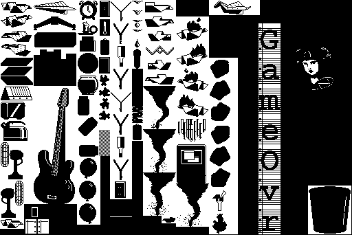

**02.** The same bug in a color room backdrop (PICT 201), almost all black.

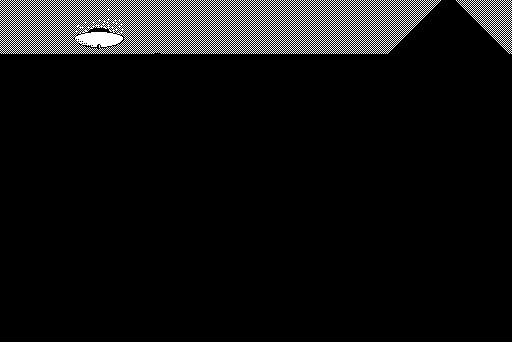

**03 and 04.** The two pictures after fixing the color table indexing.

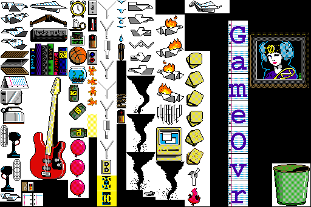

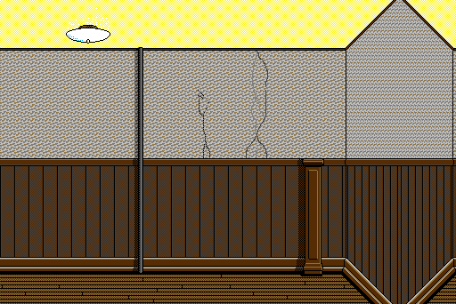

**05.** The color title picture (PICT 210).

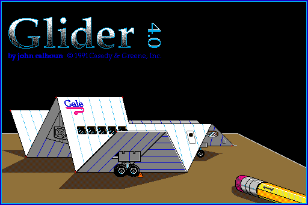

**06.** Apple's Chicago 12 bitmap font and ChicagoFLF rasterized at 12 pixels, compared on Glider's strings and every glyph. Black is both, red Apple's only, blue ChicagoFLF's only.
Most glyphs differ by a pixel here and there, and one-pixel differences in advance widths (the em dash, `#`, `%`, `\`) shift everything after them in a string. The port uses Ozma, a bitmap font drawn to Chicago's metrics, instead of either.

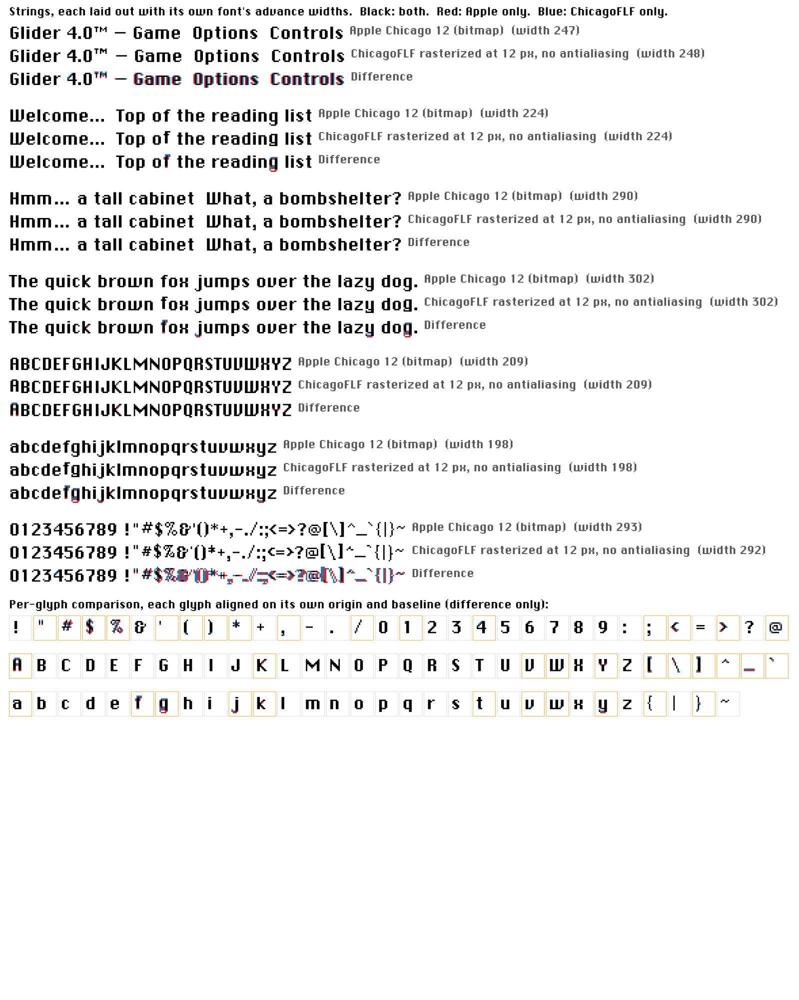

## The oracle

Mini vMac built headless, with System 6.0.8 and Glider 4.06 on its disk, Glider as the startup application.

**07.** The first boot of the headless Mac Plus, to the Finder (0.12 seconds for 20 emulated seconds).

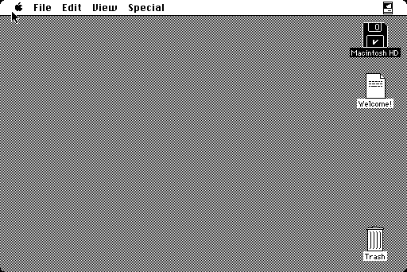

**08.** Glider's first start in the oracle, ticks 300, 600 and 900. Glider looks for its "MacsBug" file, really an INIT that reserves the Mac Plus's alternate screen for page flipping, and without it asks for it. The oracle's disk now has a stand-in.

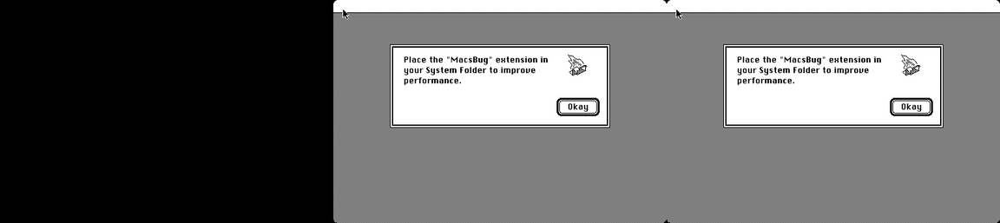

**09.** With the stand-in: ticks 300, 600 and 900. Glider's saved preferences name another keyboard than the emulated Mac's, so Glider switches to its default keys and says so.

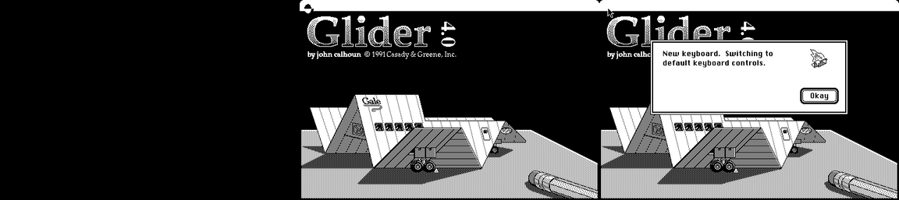

**10.** The alert dismissed by a script: the alert, then the area it covered blank until Glider redraws, then the menu bar.

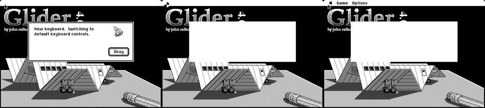

**11.** A new game started by the script: the hint box, the title dissolving into the first room in blocks, then the room.

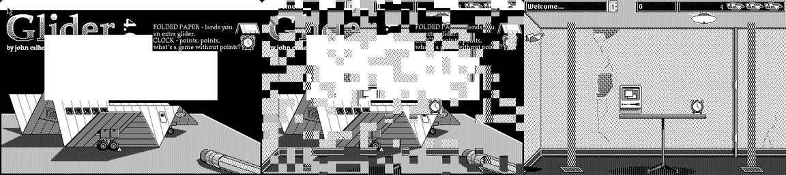

**12.** The same alert on the Mac II in color at 640 by 480, with the side panels and Glider's gray alert.

## Measuring QuickDraw with test pictures

Glider draws its title with `DrawPicture`, so a copy of Glider whose title picture is replaced shows how the ROM draws any picture (the picture oracle).
Glider's own hint box and demo glider are drawn over it.

**13.** An empty test picture in place of the title: what remains is Glider's hint box, a demo glider at the left, and the menu bar.

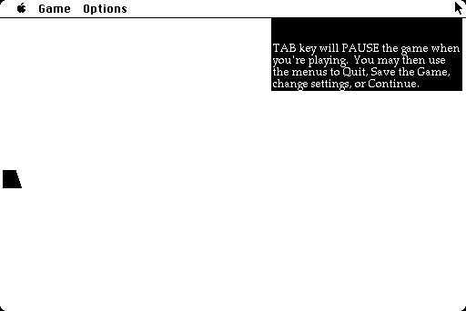

**14.** On the left the real title picture through the picture oracle; on the right a picture with nothing but a black rectangle, which the ROM did not draw.

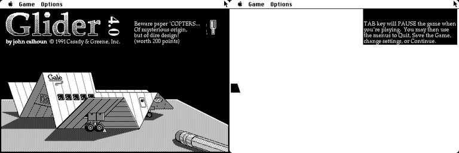

**15.** Variants of that picture; the ones that set a clip region first draw the rectangle (top left). `DrawPicture` draws nothing until the picture sets a clip region; every real picture does.

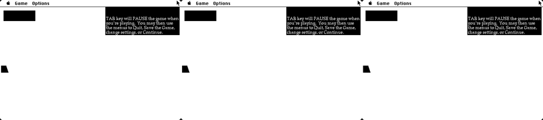

**16 and 17.** When the title settles, with a test picture of one black rectangle: the picture is up by tick 580, before the menu bar, and the hint box and demo gliders come and go over it later. Runs now go 32 times faster and are shot at tick 100.

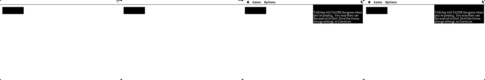

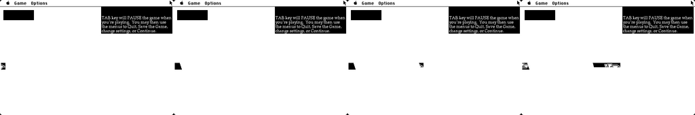

**18.** The mask of pixels Glider draws over the picture (black), found by drawing an all-black and an all-white picture; tests ignore those pixels.

**19.** The all-black and all-white pictures on the Mac II (halved).

**20.** The first QuickDraw test comparison (three panels). The ROM drew nothing for the rectangle painted in pen mode `srcOr`, where the port treated modes 0 to 7 as pattern modes.

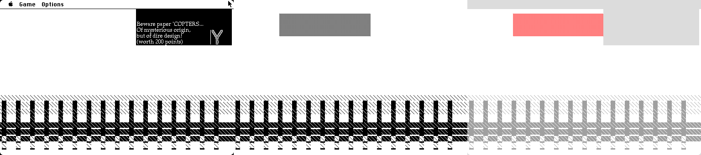

**21.** The ROM drawing shapes and lines in pen modes 0 to 7 over half black: shapes act as pattern modes with a black pattern, and lines draw nothing. Glider uses `srcOr` and `srcXor` as pen modes.

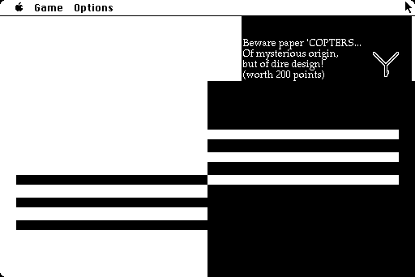

**22 and 23.** Small ovals by the ROM and by the port's first rule, enlarged; some rows differ by a pixel. A grid of every size from 1 by 1 to 24 by 14 then measured the rule.

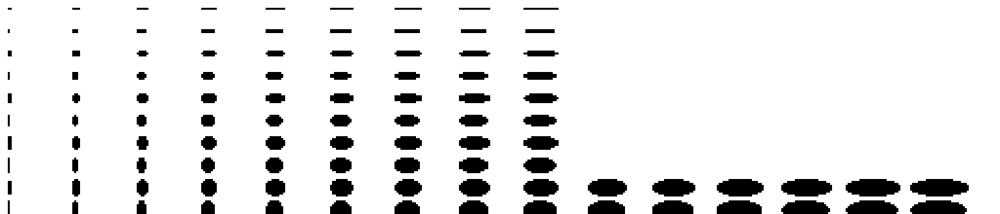

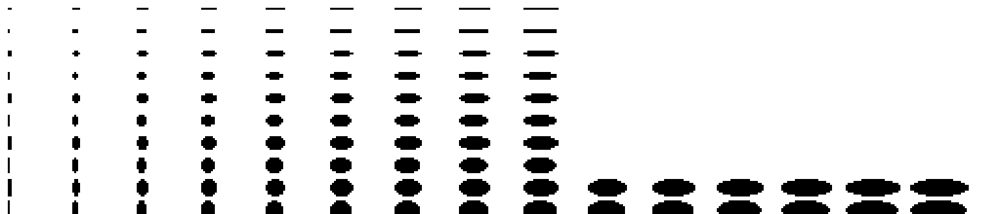

**24.** A Mac II picture run whose render was solid black: the screenshot was taken before the picture was drawn, with only the side panels up. Faster runs fixed it.

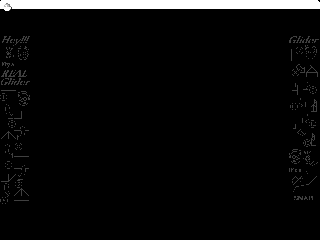

**25 and 26.** Rounded rectangles (three panels, shrunk, then one row at full size). Rounded rectangles stretch their corner oval's edges, not its region.

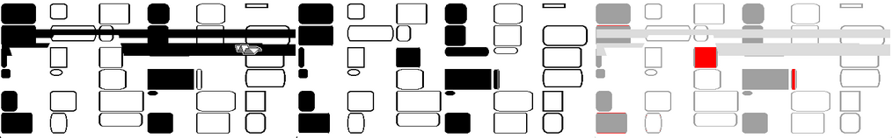

**27.** Text in several fonts and in every text mode (three panels). The differences in the digit font's row repeat every 24 pixels, which led to the long-string case.

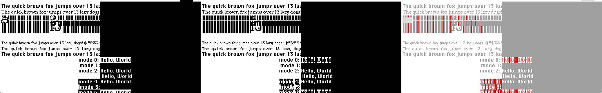

**28.** The color shapes test on the Mac II (three panels): a shadow polygon drawn over color bars in a transparent mode has its dither in the other phase. The pattern turned out to be inverted for regions that are not rectangles (refined in [`2026-10-18-rooms-and-dialogs/`](../2026-10-18-rooms-and-dialogs/)).

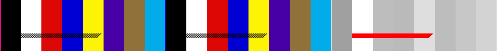

## The System 6 interface

Screenshots of the original, measured before writing the Window, Menu and Dialog managers, then the first comparisons.

**29.** The alert at full size, measured for its frame and button.

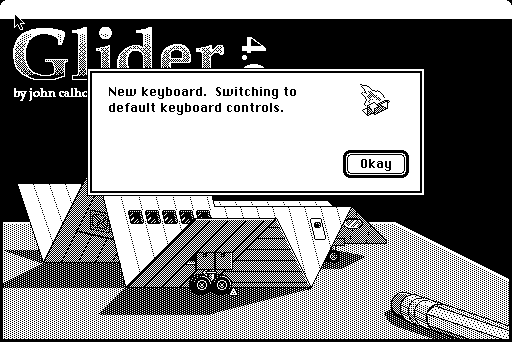

**30.** The Mac II at tick 600, while Glider draws its side panels.

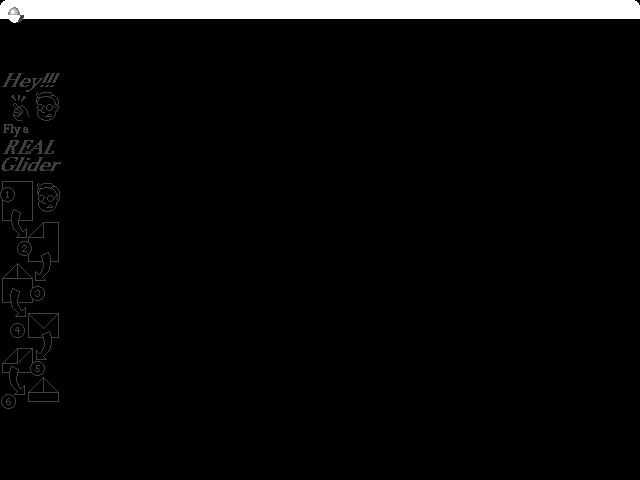

**31 and 32.** The menu bar's rounded corner and the alert's double frame, enlarged.

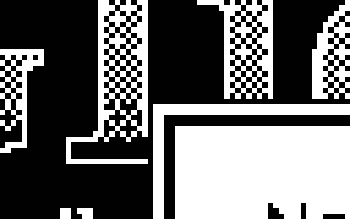

**33.** The original between hints: the hint box is blank white while Glider redraws it.

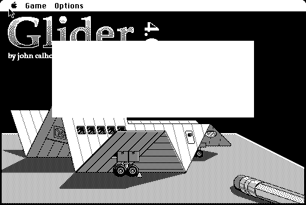

**34.** The first room in the oracle's early runs. The zigzag columns above the floor vents are the vents' air, which Glider draws when "Air is Visible" is on; the oracle's disk then had other preferences than 4.05's.

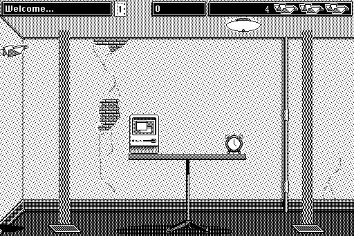

**35–38.** Glider's menus in the original: the Game menu, the hierarchical Controls menu, and on the Mac II their colors from `mctb`.

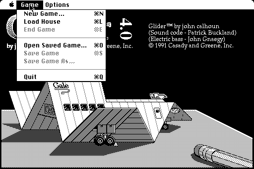

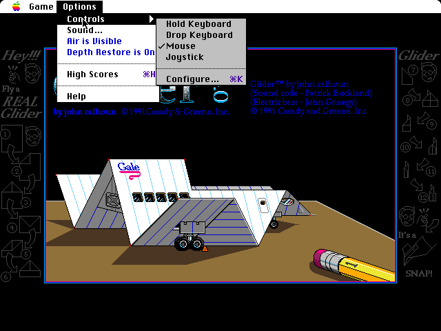

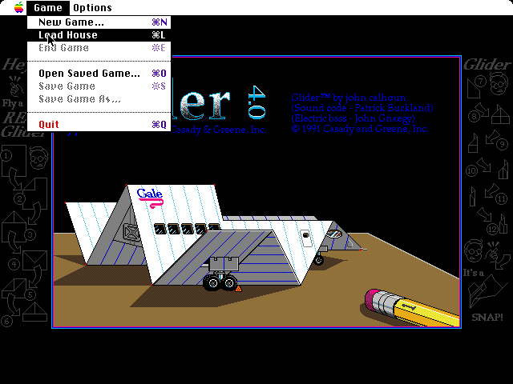

**39, 40, 41 and 42.** Glider's dialogs in the original.

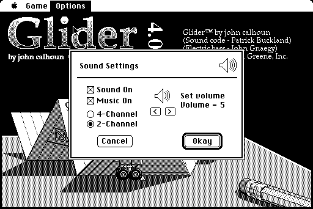

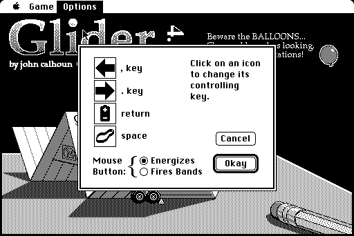

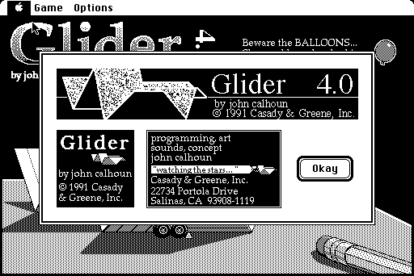

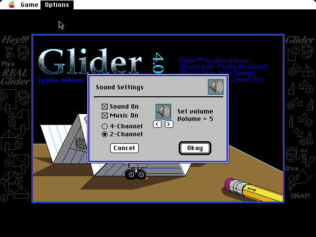

**43.** The first menu comparison (three panels, enlarged): the port's disabled items were dimmed differently, and its background was the desktop pattern, not the title.

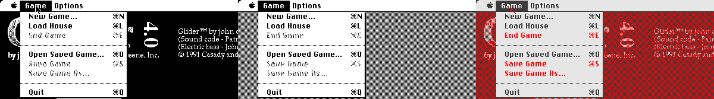

**44.** The same in color: the port dimmed "Depth Restore is On", which the original leaves enabled on the Mac II.

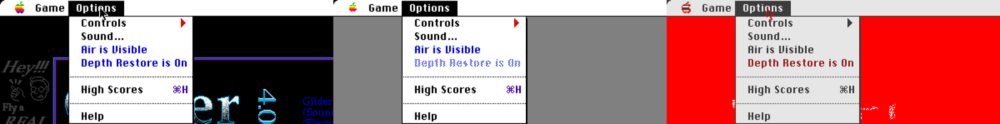

**45.** The port's alert text came out in Geneva: the dialog's font was set on the wrong port.

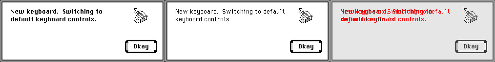

**46.** The port's color alert icon drew white where the original's has its colors.

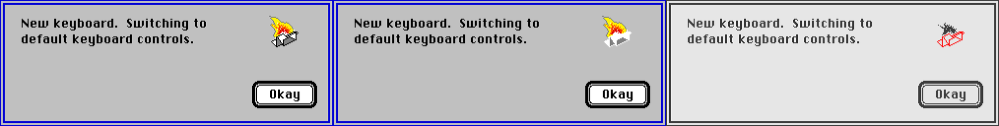

**47.** The Sound Settings dialog: the port's Cancel button and small arrow buttons were rounded and placed differently.

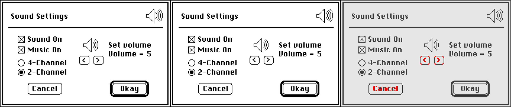

## The first games

**48 and 49.** The port's own startup screens, the first time a run reached tick 600; both then matched the oracle pixel for pixel.

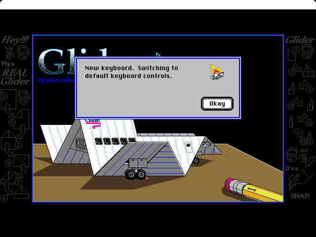

**50, 51 and 52.** Side by side (port left): the original, at a real Mac Plus's speed, is still on its title when the port's game has begun, and its first room shows visible air.

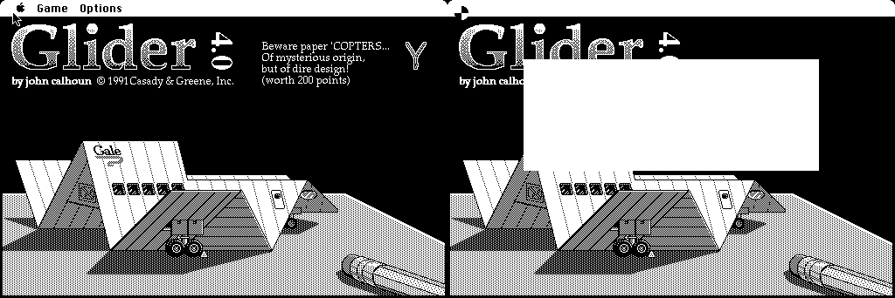

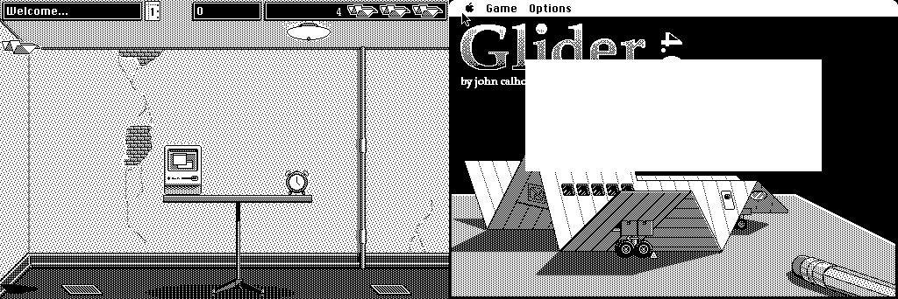

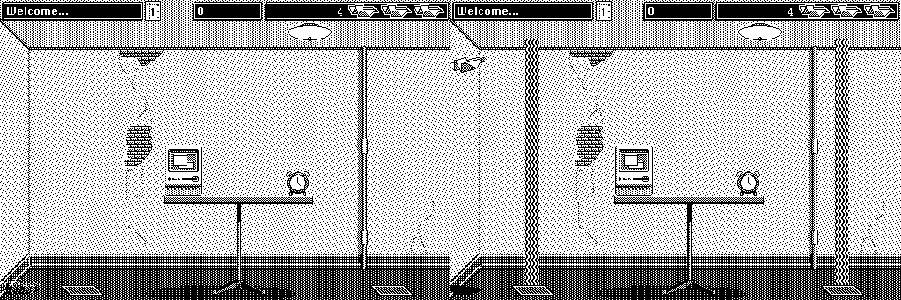

**53 and 56.** With the oracle's CPU sped up, the frames match closely; four of twenty identical. The title differs only in which hint is up.

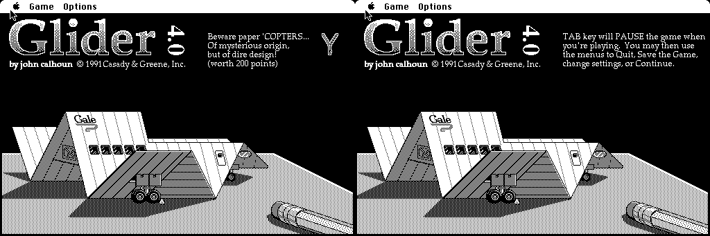

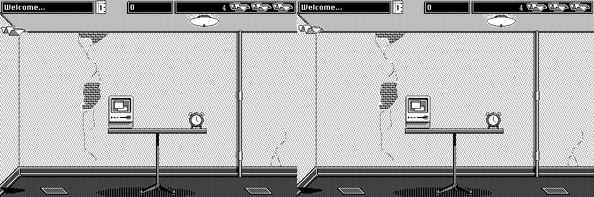

**54 and 55.** The glider enlarged, port left: the original's is 3 pixels higher and in another pose, a frame or so behind.

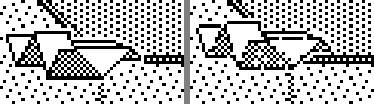

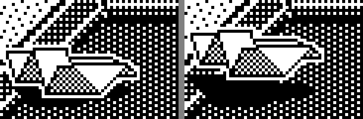

**57 and 58.** The first steering run: holding the arrow keys did nothing, because after the alert Glider uses its default keys, comma and period.

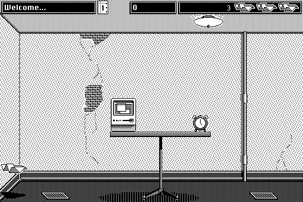

**59, 60, 61 and 67.** Steering with the right keys (three panels): the gliders drift apart, the original's about 17 pixels further left by `left40`. The port pressed keys at a fixed latency; the original's real key timing was needed.

**62–64.** The alert's dismissal tick by tick (three panels). At 901 the original's button flashes, inverting its whole rounded rectangle, frame included; at 904 the port has already redrawn the title while the original still shows the alert.

**65 and 66.** The original alone, one tick per panel: the alert's area is blank for two ticks, then the menu bar and the title come back. The trap trace was written to explain these ticks.

**68.** A whole game, to the high-score dialog (three panels). The original says "number 4" and shows another name: the oracle played 4.06's house, whose score table differs from the port's. Since then the oracle's scores match the port's (69, 70).

**69 and 70.** The original's game over and high-score dialog, at shots 40, 50, 60 and 70, 90, 119.

**71.** The tour on the Mac II, shot 8: the shelf's shadow. The original draws it as a dither of black and wall gray, the port drew it in tan and black: transparent-mode patterns are aligned differently for shapes that are not rectangles (the rule was refined later).

**72.** The selected name in the high-score dialog: the port inverted the pixel values, which turns gray (index 12) into red (index 3); the original's TextEdit highlights in hilite mode, which swaps the background color with the highlight color.

## In the browser

**73.** The port in headless Chromium at the page's scale, after a commit in which the arrow keys did not steer for the user: the browser's Mac II reported another keyboard than the preferences', so Glider switched to comma and period. The browser's Mac II now has an Extended Keyboard.

**74 and 75.** The first room in the browser, then shrunk. The wall looks tan and the carpet blue, and a "wrong colors" bug was chased; the wall is a gray and tan dither, the floor a dither too, and scaling blended them.

**80.** The wall at full size, enlarged by whole pixels: the gray and tan checkerboard.

**76.** The port's diamond in place of Apple's logo, in color and in black and white.

**77 and 78.** The diamond menu pressed.

 

**79.** Starting a game from the Game menu rather than ⌘N, the user's path, while the arrow keys still failed for them.

**81.** After a right arrow sent as xrdp sends it (the keypad's 6 with NumLock off): the glider flew right. The port now takes any event whose `key` is an arrow as that arrow.

**82.** The original's Controls menu, to find where a script must move the mouse to choose Mouse and Joystick.

**83.** A minute of random play: one shot of 180 differed, 14 pixels in a column. It went away when the Plus cases were re-run, so the oracle's shot was stale.

