# Rooms and dialogs, 18 October 2026

[All galleries](../)

Screenshots from verifying games in other rooms, test rooms, and Glider's dialogs against the oracle (see the journal in [`PORT.md`](../../../PORT.md), entries "rooms" onward).
They are the original's screens in the emulator, the port's, and comparisons of the two.
[`2026-10-17-pictures-oracle-and-first-games/`](../2026-10-17-pictures-oracle-and-first-games/) has the earlier ones.
[`2026-10-19-sound-endings-and-saved-games/`](../2026-10-19-sound-endings-and-saved-games/) continues from here.

The comparison images have three panels: on the left the original (the oracle's Mini vMac), in the middle the port, and on the right a gray copy with the pixels that differ in red.
In the oracle and in the tests the menu bar shows Apple's logo, as the original does; the port itself shows a diamond.
Each caption comes before its picture, numbered as the files are. Click a picture to see it at full size: GitHub shrinks wide ones to fit the page, which blends their dithered pixels, and the details are in single pixels.

## CopyBits and CopyMask

**01.** The first test picture of stretched images, drawn by the Mac Plus ROM.
One 48-by-24 image, copied at many sizes in srcCopy, srcOr and srcBic over a half-black background, measured which source rows and columns the ROM takes for each destination pixel.
Glider draws its own hint box and demo glider over the picture, which hid some of the copies; the later layout keeps below the hint box, and its image has better-mixed pixels (this one's made 13-pixel runs that left the measurement ambiguous).

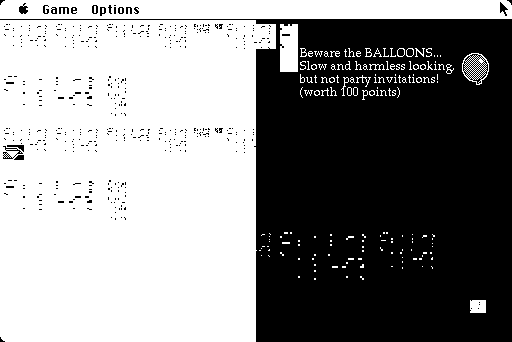

**02.** A test room of 16 power switches, one at each alignment to a 16-pixel word, on the Mac Plus original.
Every switch lost its right two columns. The ROM's CopyMask was suspected and disassembled, but the cause was Glider 4.06: it narrows switches to 16 pixels, which 4.05 does not. The oracle's copy now gets 4.05's code.

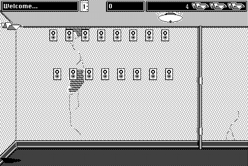

## Transparent patterns on the Mac II

**03.** Room 9. The cabinets' shadows (red) have their gray in the other phase in the port.
The port shifted transparent patterns by the shape's bounding box; regions turned out not to be shifted at all.

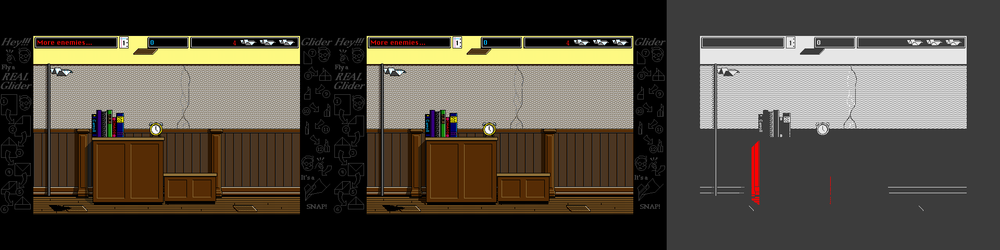

**04.** Room 15. The port's oval shadow under the table is solid black: its gray falls between the floor's dark pixels instead of on them.
Ovals and polygons turned out to have their pattern's bits inverted.

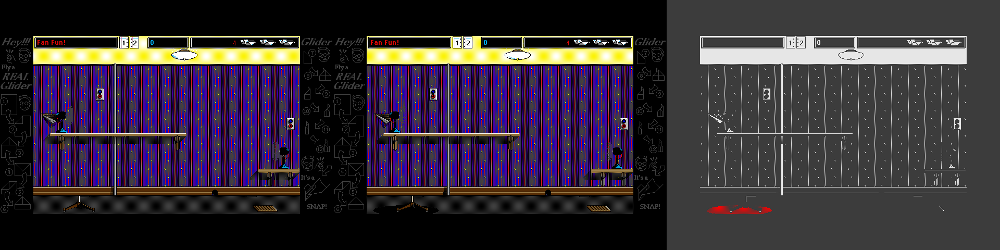

**05.** The Mac II ROM painting regions with a pattern of one dot in each 8 by 8 cell.
Dots appear in a single column (x = 408) and nowhere else, so non-gray patterns in regions are rendered sparsely by the ROM; Glider only uses gray. (The black shapes at the left and the box at the top right are Glider's demo glider and hint box.)

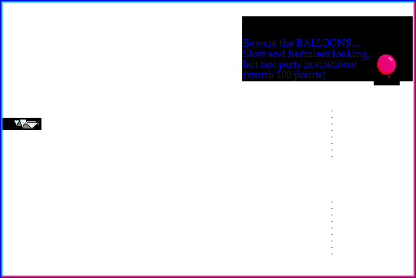

## Input timing

**06.** Room 27 with the lights off. The port's glider is 5 pixels from the original's: the port turned it a frame later.
The key came over ADB and the original read it in the same tick, which led to the emulator's new traces of ADB key events and GetKeys readings.

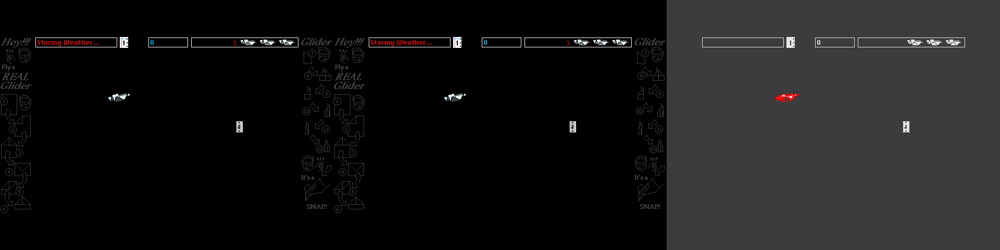

**07.** The high-score dialog on the Mac Plus original, during random play from room 15.
The name field shows the last name selected; typing over a selection shows the caret at once and restarts its blinking, which the port did not do.

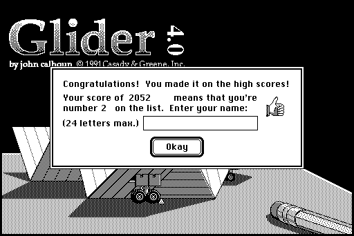

## Dialogs on the Mac II

**08.** The Configure dialog. The port's (middle) is blank, with its items squeezed into a strip at the left: the dialog has no 'dctb', so its port is an old-style GrafPort, and the port drew it at one bit per pixel into four-bit screen memory. Color QuickDraw draws such ports through the screen's pixel map.
(Regenerated afterwards by turning the fix off for one run.)

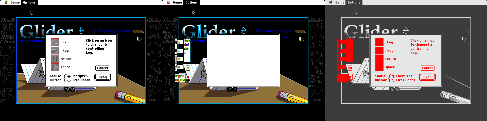

**09.** The same dialog in an unmodified Glider 4.06 on the oracle, taken while ruling out the oracle's changes to 4.06. The original was never wrong here: the comparison's panels had been read backwards.

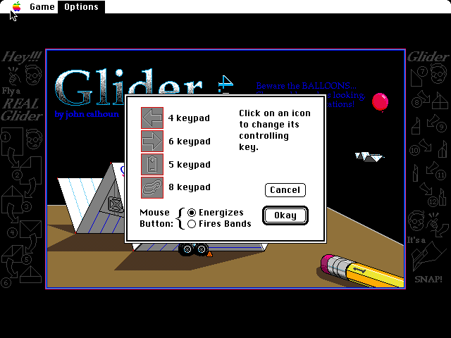

**10.** After that fix, the port's key icons are black and white where the original uses the 'cicn' resources of the same IDs, even though the dialog is not a color window.

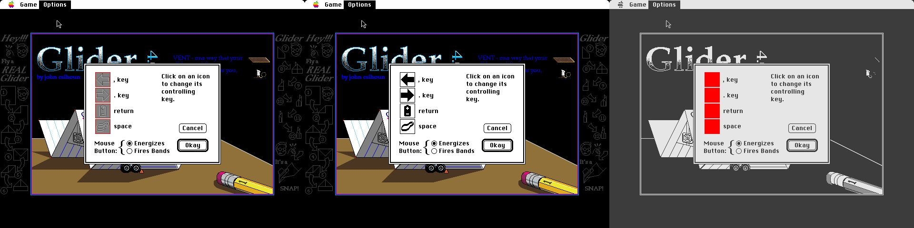

**11.** The About box. The port drew two of the icons in its picture as white squares: they are one-bit color icons, which the original draws in their color tables' colors.

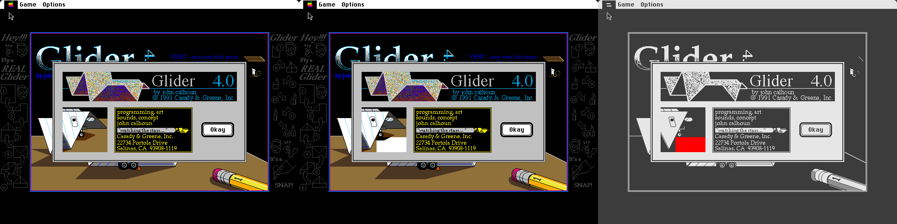

**12.** The first help screen. Glider copies it with a cyan background color, and the original colorizes the pixels, (value AND fore) OR (NOT value AND back); the port copied them unchanged.

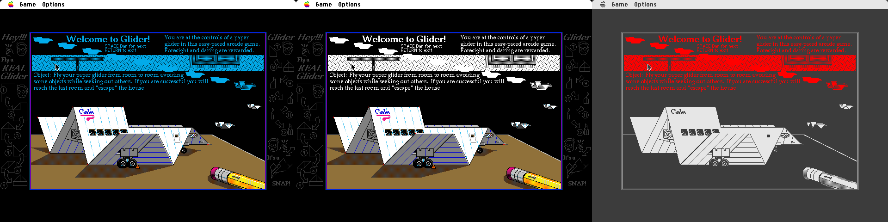

## A rank on the Mac II

Unexplained when these were taken; the cause turned out to be in the oracle, not in Glider or the ROM.

**13.** The high scores after random play from room 35. Two pixels differ: the second entry's name has one more period in the port.

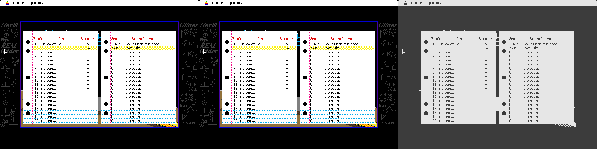

**14 and 15.** The dialog before it, tick 2572. With the same score, 3308, the original on the Mac II says "number 4", the port "number 2".

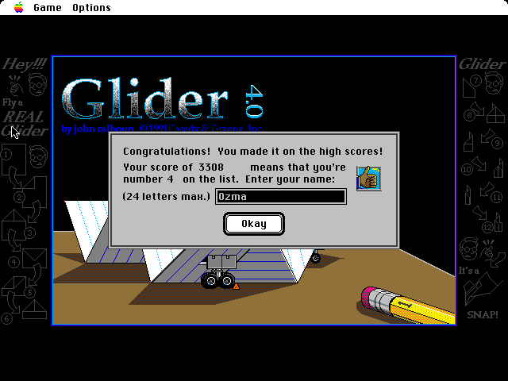

**16.** The Mac Plus original, in the same game, says "number 2".

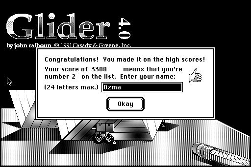

**17.** The top of the original's list afterwards, enlarged: the score is second, as "number 2" would have it.

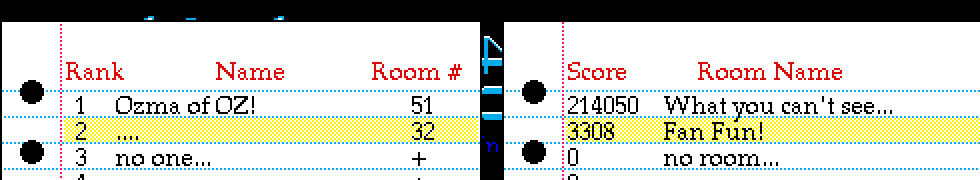

The "number 4" frame came from a second oracle run made to take a screenshot every tick, and that run booted from the disk the case's own run had used. Glider had saved that game's 3308 into the house on the disk, and an earlier per-tick run had added another, so the replayed game ranked below both. The case's own shot at that tick says "number 2", and a RAM dump of a run on a fresh disk has the rank at 1. Oracle runs now boot from a copy of their disk.
