# The desktop, 19 October 2026

[All galleries](../)

Screenshots for the port's desktop, the program that plays the Finder's part: what you see after quitting Glider, with Glider 4.0, the Room Editor and the source code as icons ([`PORT.md`](../../../PORT.md), decision 16).
All are the oracle's: System software booted on the emulated Mac Plus and Mac II.

Each caption comes before its picture, numbered as the files are. Click a picture to see it at full size.

## MiniFinder, considered and dropped

The plan was a launcher after MiniFinder, remembered as System 6's. It is not: the Finders of System 5.0 and 6.0 have no trace of it, and System 4.1's Finder (5.5) has it as "Use MiniFinder…" in its Special menu, which installs it for the documents and applications selected.

**01.** System 4.1's MiniFinder on a Mac Plus, installed for Glider and two houses, as the Mac starts up: a window of icons and a window of buttons, headed by the disk's name, on the gray desktop, with no menu bar.

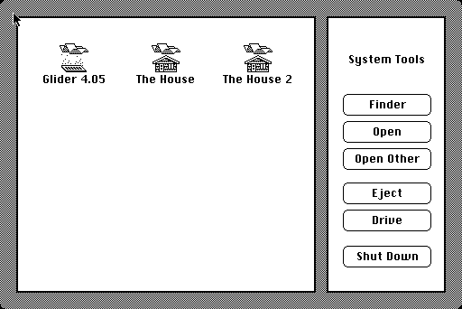

**02.** Glider selected: a frame around its icon and name.

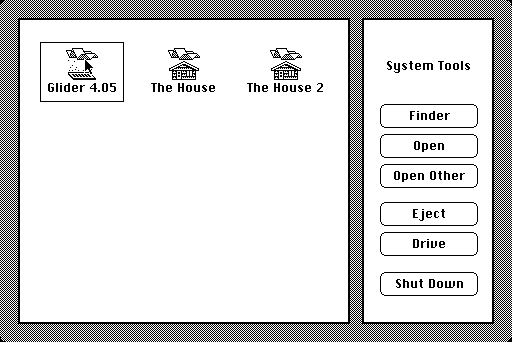

**03.** The same on a Mac II: MiniFinder keeps its Mac Plus layout, in the screen's top left corner.

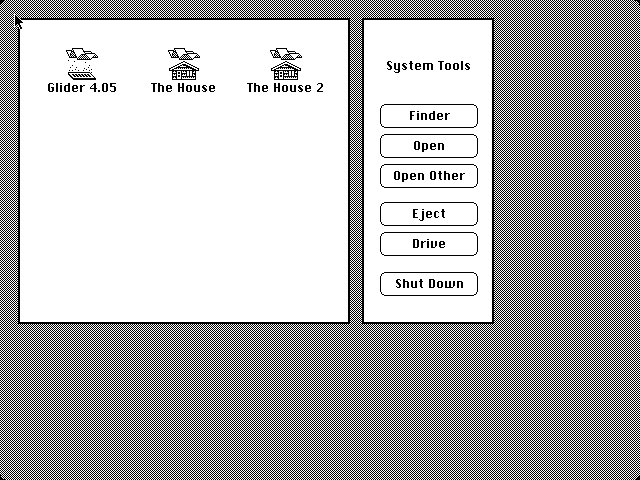

**04.** System 4.1's Shut Down: "You may now switch off your Macintosh safely." on a black screen, with Restart.

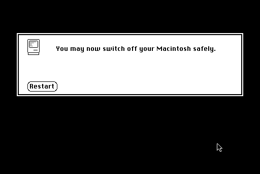

With no menu bar for the browser's own operations, and two plain windows of buttons, MiniFinder looked less like a Mac than the Finder's desktop. The port's desktop follows System 6.0.8's Finder instead.

## System 6.0.8's Finder

**05.** The Finder's Special menu on a Mac Plus (with MultiFinder, whose icon is at the right of the menu bar).

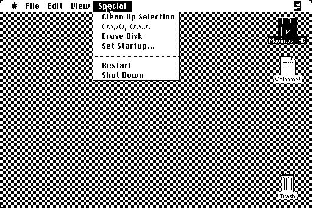

**06.** System 6.0.8's Shut Down on a Mac Plus: the same words, another icon, and Restart at the right. The port's says "You may now close this window safely." A Mac II, whose power the Mac can switch off, just turns off.

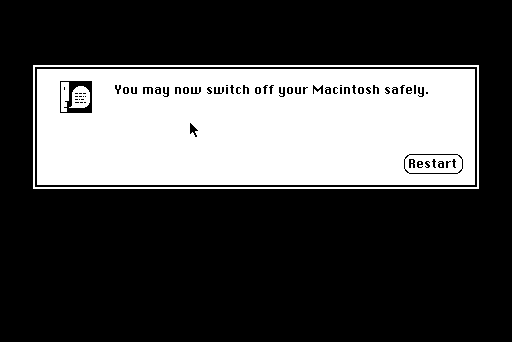

## The Finder, measured

The oracle's case `desktop` boots System 6.0.8 into the Finder (without MultiFinder) with Glider 4.0, the Room Editor and a Source Code folder on its disk, drags them out of the disk's window onto the desktop, and cleans up.

**07.** The Finder's desktop after Clean Up: a column 56 pixels in from the right edge, a place every 64 pixels from 28 down, the disk first and the Trash last. Each icon is drawn through its mask (the gray shows around it, and in the holes of Glider's), with its name in Geneva 9 in a white box 4 pixels wider than the name.

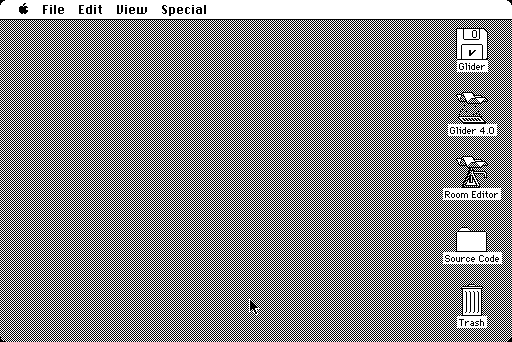

**08.** Opening Glider: the zoom, a tick after it began. The Finder's routine was read from a RAM dump (found with a trap trace of `FrameRect`): twelve dotted rectangles between the icon and the screen, a fraction of the way that starts at 176/10000 and grows by 7/5, one a tick, each erased four ticks later. Before the arguments were read off the stack, a fit put the end of the zoom at a rectangle well outside the screen; the true end is the screen itself, reached at a fraction of about 0.7.

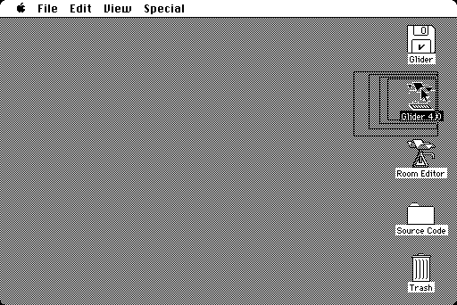

## The port's desktop

**09.** The port's desktop on a Mac Plus: the Finder's desktop with the three icons alone, Glider in the disk's place, and a menu bar of its own. The tests compare each icon and name with the Finder's, a place lower, and the zoom rectangle for rectangle.

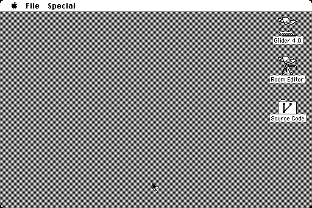

**10.** Glider selected on the Mac II: the icon inverted inside its mask, the name white on black. A click anywhere in the icon's square selects it, holes in its mask included, as in the Finder: the first version tested the mask, and on the Mac II a click between Glider's glider and its base did nothing.

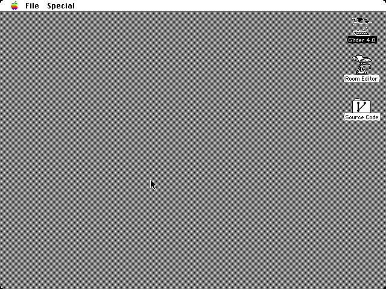

**11.** About the Desktop…, an alert with Glider's icon and the notice the MIT License asks for; the license's whole text is served beside the page.

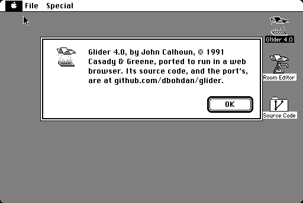

**12.** Shut Down: System 6.0.8's last screen, the same to the pixel but for the words and the icon (Glider's, in place of Apple's). Its button's title was a pixel off at first: Chicago's R starts a pixel into its glyph.

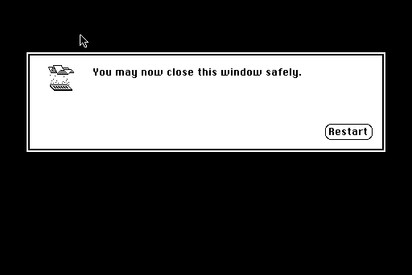

**13.** Source Code's icon, enlarged: System 6's folder, measured in the Finder's window, with the branch graph of Jason Long's Git logo inside it.

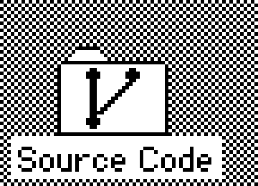

## The browser's operations

The desktop's menus hold what a Mac's disks did: File > Import Files… and Export Files…, and Special > Reset Preferences and Scores….

**14.** Import Files… after choosing a bare house, a saved game in MacBinary, and a text file. Import reads MacBinary and AppleSingle files, ZIP archives of them (a macOS archive keeps resource forks and types under `__MACOSX`), and bare houses and saved games, known by their sizes. Export Files… saves a ZIP archive of MacBinary files, which Import reads back.

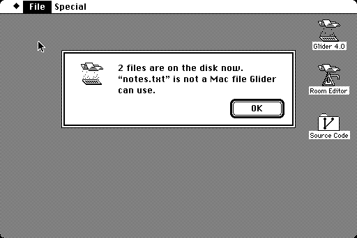

**15.** Reset Preferences and Scores…, which puts back Glider's preferences and the high scores of the houses that came with it.

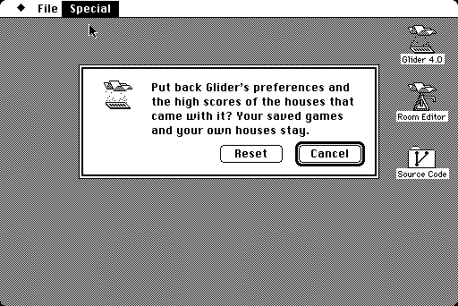

**16.** The imported house in Glider's Load House…, in a page loaded afterwards: the browser keeps it.

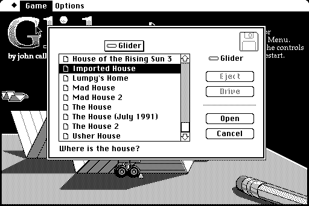

**17.** Import Files… after choosing `LaVillaStrangiato.sit`, a fan-made house from the Macintosh Garden in a StuffIt archive. The archive also holds two read-me files; from an archive, Import takes only what Glider uses (houses, art, saved games).

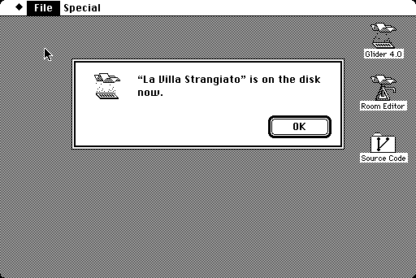

**18.** La Villa Strangiato's first room, opened with Load House… in a page loaded afterwards.

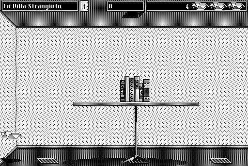
