# Sound, the end of a house, and saved games, 18 and 19 October 2026

[All galleries](../)

Screenshots from the work after [`2026-10-18-rooms-and-dialogs/`](../2026-10-18-rooms-and-dialogs/): the last differences in random play, sound, the browser's storage and icon, and the first comparisons of finishing a house and of saving a game (see the journal in [`PORT.md`](../../../PORT.md), from "oracle disks" to "saved games").
Like the earlier ones, they were recovered from the session's transcript, as they were looked at.

Most of this stretch's work left no pictures: sound was compared as samples, tick by tick, and the speed of a real Macintosh SE was measured from the sound of a video (the journal's "sound" entry tells how).

In the oracle and in the tests the menu bar shows Apple's logo, as the original does; the port itself shows a diamond.
Each caption comes before its picture, numbered as the files are. Click a picture to see it at full size: GitHub shrinks wide ones to fit the page, which blends their dithered pixels, and the details are in single pixels.

## Keys held as a repeat falls due

**01.** The name field of the original's high-score dialog after each of six holds of the period key: 24, 30 and 36 ticks, each released in the tick a repeat falls due, then 23, 29 and 35, a tick earlier; the Mac Plus above, the Mac II below.
The Mac Plus took the release before the repeat every time. The Mac II took the repeat first at 24 and 36 ticks and the release first at 30: a race within the tick between the ADB keyboard and the program.
No rule can predict that, so the emulator now reports each auto-key event it makes, and the tests follow it.
(The red bars are the Mac II's caret: TextEdit inverts it onto the gray, and the inverse of the gray's color index is red's.)

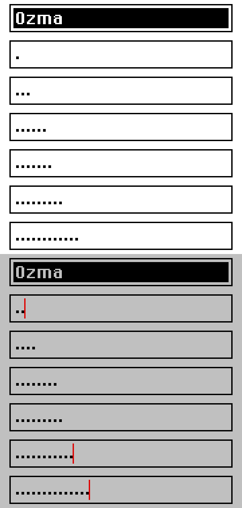

## A pixel off in the game over, room 9

**02.** The "G" card of the game-over animation at tick 1710 on the Mac II, original left, port right, enlarged: the lower part of the card is a pixel to the side in one of them.
The cards fall in 8-row steps with a random sideways shift, and the original was one call to `Random` ahead.

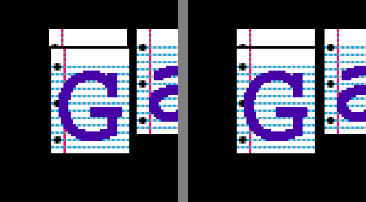

**03.** The whole frame, original left, port right.
The extra call came from the closing animation before it: it stops when `GetKeys` sees Return, and in the tick Return came, two calls missed it and a third saw it, so the original drew one more step than the port. The emulator's trace of `GetKeys` now says how many calls came before in the tick, and only the first counts as seeing a key as the tick begins.

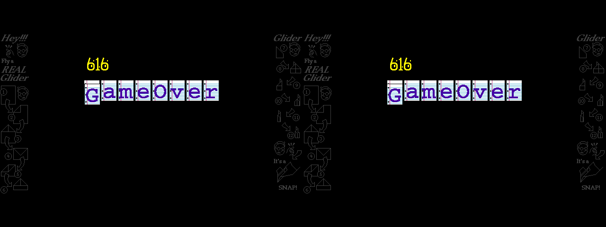

## The browser

**04.** The page in headless Chromium after reloading with an old stored copy of the whole Glider application, as the player's browser had one. The page now keeps only the player's part of the game's files: Glider's preferences and the bundled houses' high scores ([`PORT.md`](../../../PORT.md), decision 13). The old record was read for its preferences, and the game started from the bundled files.

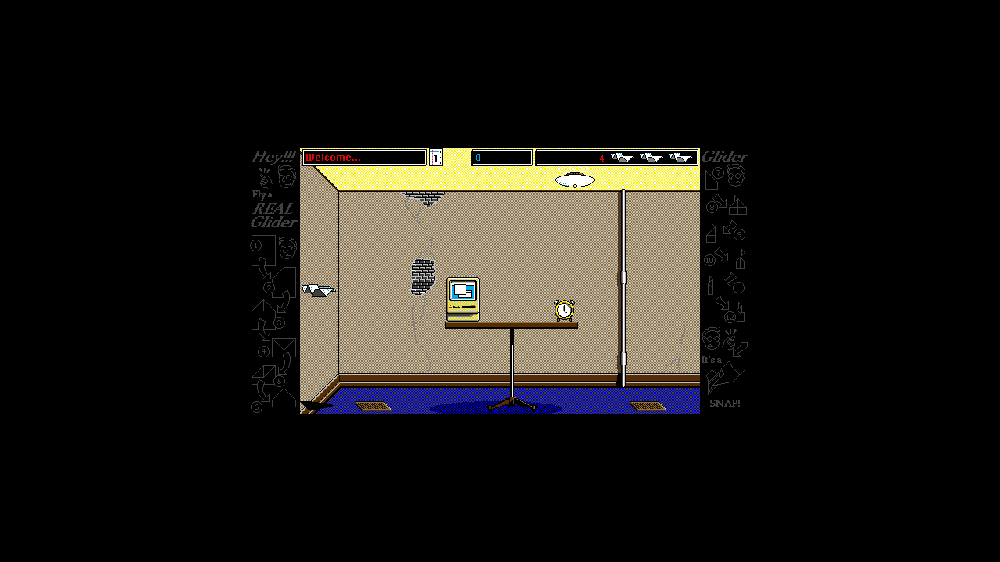

**05.** The page's icon, enlarged eight times: Glider's own application icon, its 8-bit color icon in the Mac's standard colors with the black-and-white icon's mask for transparency, written as a PNG when the resources are built.

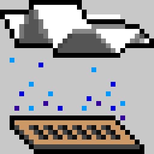

## Finishing a house

Two test houses are The House cut to its first room. Flying out of its right side, the game goes on to the next file named in the house, or with none ends: the closing animation, game over, the high scores.
The port matched both on the first try. These are the original's screens.

**06 and 07.** The next file: The House 2's first room, "Welcome to Part 2!", just after the switch, and two seconds later.

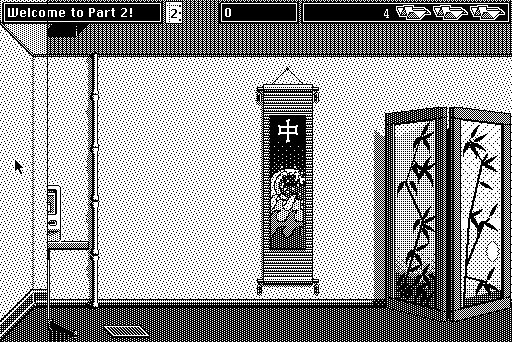

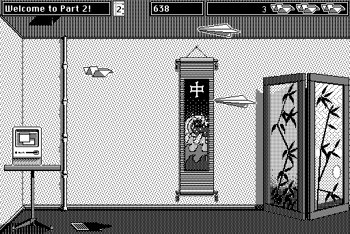

**08.** The end of the last house: the farm, the tornado and the paper glider flying off, with lightning at random.

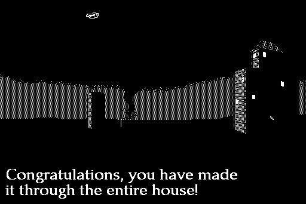

**09 and 10.** The high-score dialog after it, with the last name entered ("Ozma", from the preferences) selected, then a new name typed.

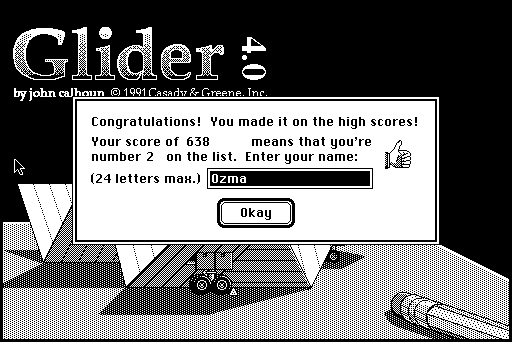

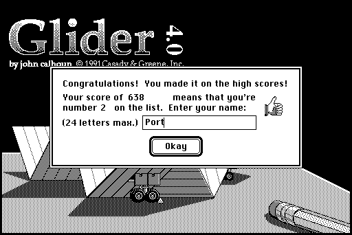

**11.** The farm on the Mac II, with Glider's side panels.

## Saving a game

The test saves a game with Command-S in Standard File's dialog, plays on, ends the game, and opens the saved game again. The port then showed Standard File as page dialogs, so the tests answered it the way the script's keys answer the original's (since replaced by the Mac's own dialogs: [`2026-10-19-standard-file/`](../2026-10-19-standard-file/)).

**12.** A first try, the original 300 ticks after Command-E: its game over was still going. The script's next step, choosing Load Game… from the menu, came during it and was lost (13), so the script now waits longer.

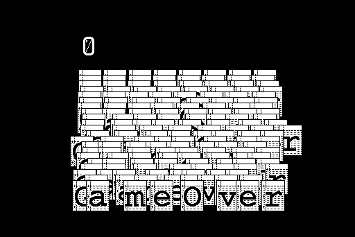

**13.** The title screen after the lost menu choice: no file dialog.

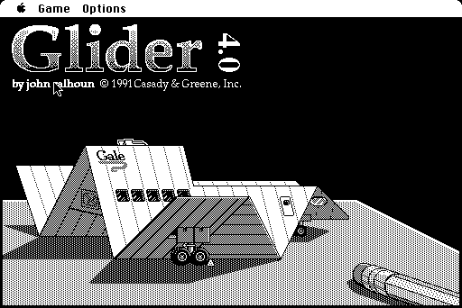

**14.** Original, port, and the pixels that differ (three panels): on the title screen after the saved game's end, the little demo glider is a step apart.
It moves every other tick, and the port's moved in the other ticks. The original's first `WaitNextEvent` after the game returned an event at once, though the game had just flushed the queue: an activate event for Glider's window, left by the save dialog when it closed. Activate events live outside the queue, and the game reads no events, so it waited through the whole game. The port's Standard File now leaves the same event.

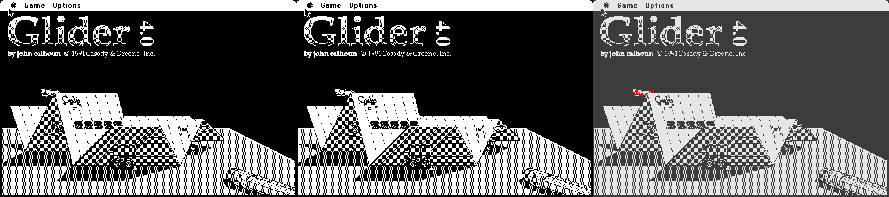
