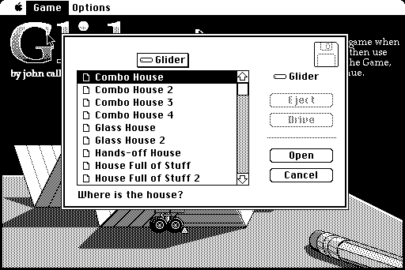
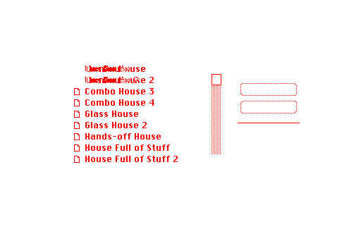
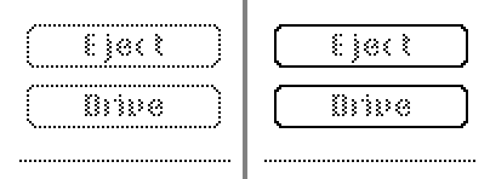
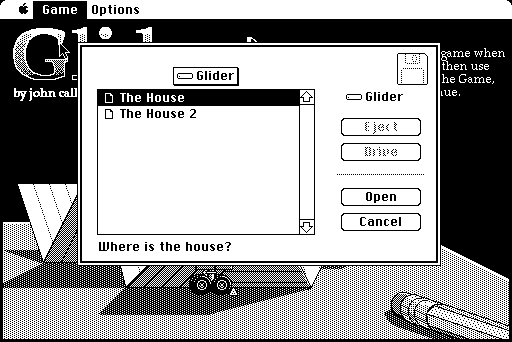
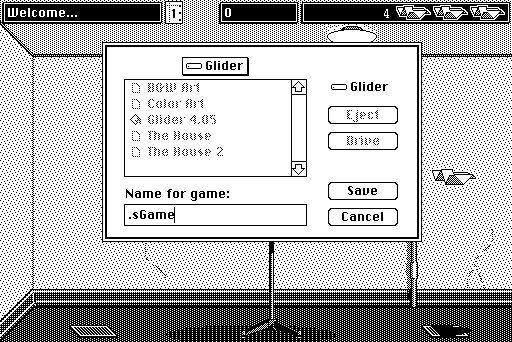

# Standard File on the Mac's screen, 19 October 2026

[All galleries](../)

Screenshots from replacing the page's file dialogs with the Mac's own: System 6.0.8's Standard File, read from its code (PACK 3) and drawn by the port's Toolbox (see the journal in [`PORT.md`](../../../PORT.md), "Standard File").
The first two were recovered from the session's transcript, as they were looked at; the others are the port's screens, which are now identical to the original's.

Each caption comes before its picture, numbered as the files are. Click a picture to see it at full size: GitHub shrinks wide ones to fit the page, which blends their dithered pixels.

## The first try

**01.** The port's Load House… dialog on the Mac Plus, the first time it ran. It lists more than thirty houses: the test harness booted with every house the port bundles, where the oracle's disk holds only The House and The House 2. The harness's volume now holds the oracle disk's files. With more files than fit, the scroll bar is active: its gray track and white thumb.

**02.** The pixels that differ from the original's dialog, in red. Besides the list and the scroll bar, the dimmed Eject and Drive buttons and the gray line above Open differ, though nothing about them depended on the files.

**03.** The dimmed buttons and the gray line enlarged four times, the port's first try left, the original right. The original's dimmed buttons keep their frames whole, and its gray line is a pixel to the side of the port's.
Two errors had been cancelling out: the port aligned patterns with the screen, and dimmed buttons by clearing gray in the inverse mode (`notPatBic`) over the whole button, which on Glider's own dialogs, at odd positions, drew the same pixels as the ROM. System 6.0.8's button definition (CDEF 0) clears gray (`patBic`) inside the button less 3 pixels at the sides and 1 at the top and bottom, and the ROM aligns patterns with the window's own coordinates. Both are in the port now; every earlier comparison still matches.

## Matching

**04.** Load House… on the Mac Plus, the same as the original's to the pixel: the disk's pop-up above the list, the disk's name beside it, the first house selected, and Glider's own prompt below. The list is PACK 3's own, not the List Manager's: 16-pixel rows, its small icons copied from PACK 3, names sorted as `_UprString` upper-cases them and compared as signed bytes.

**05.** Save Game… on the Mac Plus, after Command-S during a game and a name typed. The files are listed dimmed, as Standard File lists them for saving. The name begins with ".s": the dialog took the period that was flying the glider and the S of Command-S, still in the event queue, before the keys typed into it.

**06.** Load House… on the Mac II, with the down arrow pressed: The House 2 selected. On a color machine PACK 3 draws the selected row with black and white set as RGB colors in its dialog, an old-style port; the port ignored colors set in old ports, and drew the row unselected, until it kept the nearest old-style color as the ROM does.

