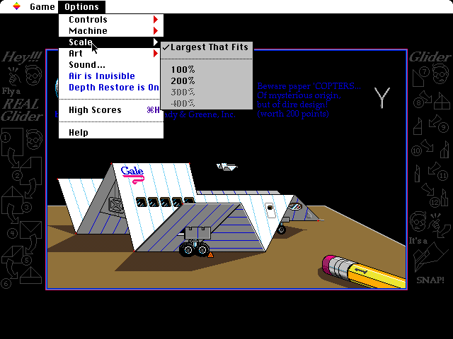
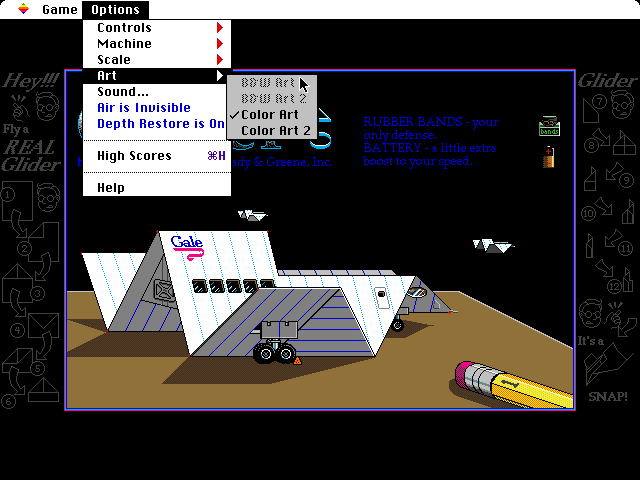
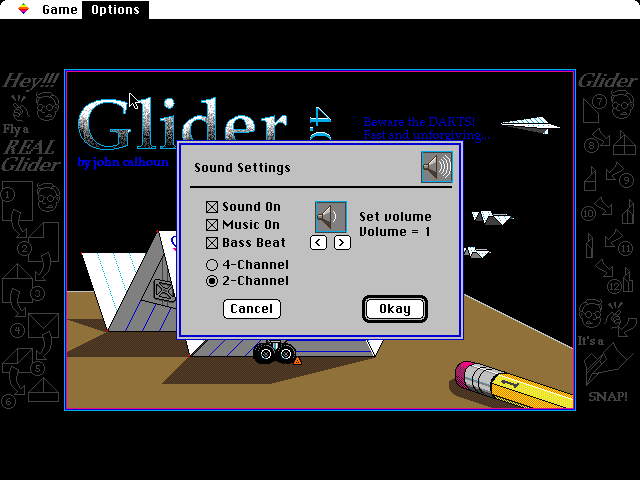
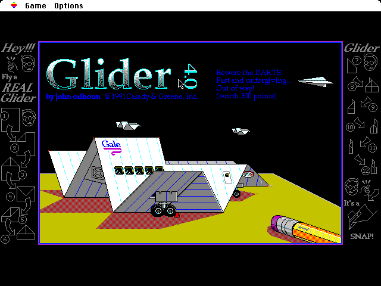
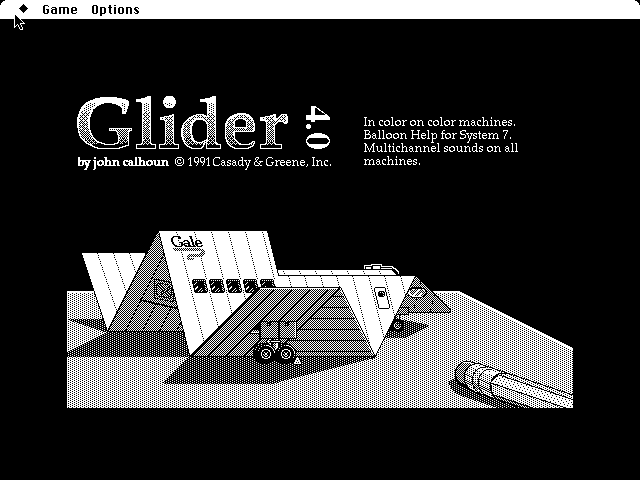
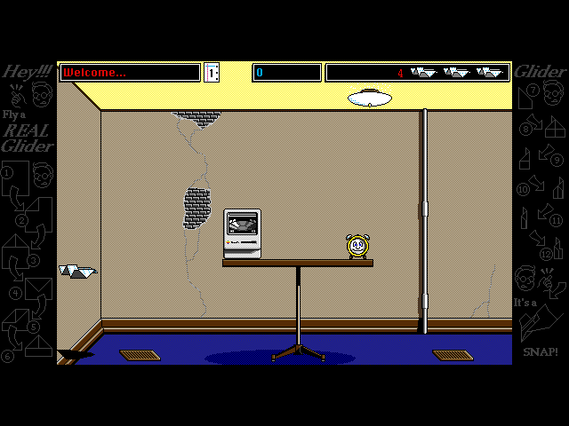

# The additions

The port's first changes to Glider itself (PORT.md, decision 14), made in its own style and from its own parts: three submenus in the Options menu after Controls, built like Controls, and a Bass Beat checkbox in Sound Settings, as Glider for Windows has.
They are on in the browser only; the tests boot Glider without them, so it stays as the oracle measures it.
All pictures are of the port on a Mac II, at the Mac's own pixels.

**01.** Options > Machine: the Mac Plus, the Mac II in 16 colors or in black and white, and the Mac II's screen in Glider for Windows' colors. Another Mac starts Glider again, through its own Quit (so its preferences are saved and a game in progress asks to be saved first); a palette on the same Mac changes at once.

**02.** Options > Scale: the largest whole number of screen pixels per Mac pixel that fits the window, or another, named as a percentage of the page's size, up to 400%; those that do not fit the window now are dimmed, as the Art submenu dims art of the other kind.

**03.** Options > Art, after More Glider's Improved Art was imported: the art files on the disk, the black-and-white ones dimmed on a color screen (Glider reads which is which from each file's 'deep' resource). Glider keeps the art's name in its preferences and opens it as it starts, so choosing other art quits Glider and starts it again.

**04.** Sound Settings with Bass Beat under Music On, the items below moved down a row and the dialog with them. The dialog is changed as it is made, not its resources. Bass Beat turns off the bass during play and keeps the jingle on entering a room; it is on unless turned off, as the Mac plays the bass, and kept in a resource of the port's beside Glider's preferences.

**05.** The title screen in "Windows, 256 Colors": each of the Mac II's 16 colors shown as Glider/WIN shows it, as a VGA card puts it on the screen. The tan desk is olive, the brown shadows dark red.

**06.** "Mac II, Black & White": the Mac II started with its screen at one bit, as the Monitors control panel can set it, and Glider in black and white.

**07.** The first room with More Glider's Improved Color Art chosen: the Mac on the table shows a picture in place of its blue windows, and the alarm clock has a face.

