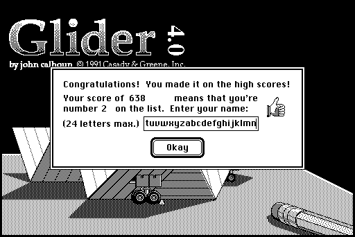

# A name longer than its field

The high-score dialog asks for a name of "24 letters max." but takes as many as are typed.
The port had wrapped a long name onto a second line; the original scrolls it sideways, then, after about 40 letters, starts over.
A new oracle case types 104 letters into the field, a screenshot after each, and four backspaces (`longName`).

**01.** The field in the original on the Mac Plus, enlarged, after letters 20, 22, 26, 34, 41, 42, 45 and 47. The text scrolls sideways one letter at a time once it reaches the field's right edge, but no further than one field's width; then the line wraps and the field shows the second line, from its start. The Dialog Manager lays a one-line field out twice as wide as it shows (read in the Mac Plus ROM at $415482), and System 6's TextEdit scrolls the caret to the field's corner, pinned to the text (read in a RAM dump, as the System patches TextEdit).

**02.** The whole screen after letter 40, the field scrolled as far as it goes.

Two smaller things showed up with the scrolling matched, both in the caret.
Backspace in the port showed the caret and restarted its blinking, as typing over a selection does; in the original it hides the caret until it next blinks, as typing does.
And in two ticks on the Mac Plus, the caret was due to blink just as a key came: the original took the key first, the port the blink. The emulator now reports, for each key given to TextEdit, whether the program had read the clock before it in that tick, and the port follows it, as it already did for repeats.
