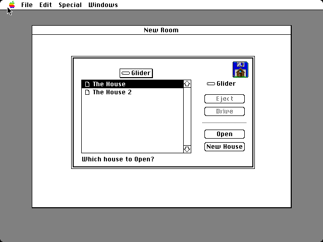
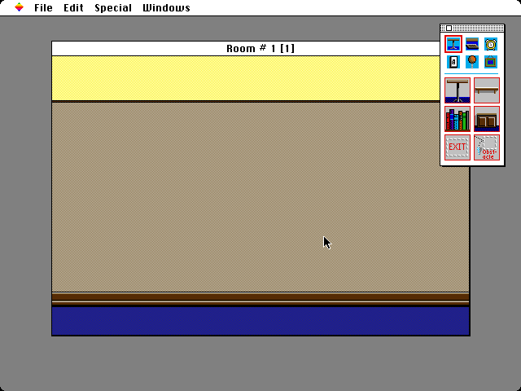
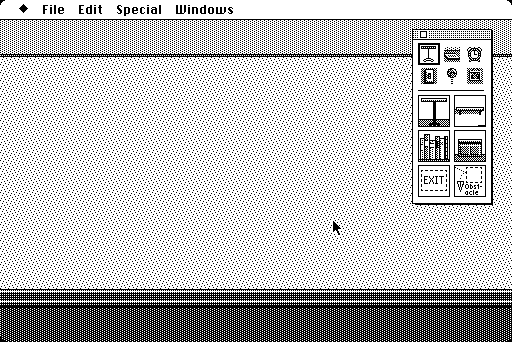
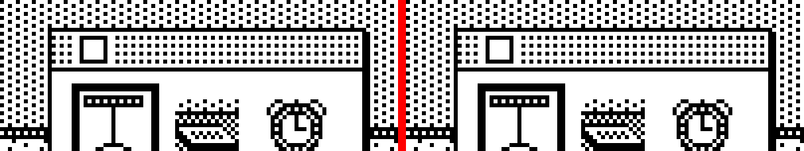

# The Room Editor starts

The Room Editor 1.03, translated from its Pascal source unit by unit, running on the port's Toolbox, beside the original (Room Editor 1.04, the release nearest the source, in the oracle).
Its first comparison: the Open House dialog, Room Background Info, and a new house's first room, on both Macs. All three match the oracle pixel for pixel, after the fixes below.

**01.** The oracle's Open House dialog on a Mac II, over the "New Room" window, which is inactive behind it (no stripes in its title bar). At first the oracle listed only a System Folder: its disk kept every file in the System Folder, and the editor's Standard File opens at the disk's root. The editor's cases now put the files at the root, as the port's flat disk has them. The window's shadow is the frame one pixel wider and taller, starting at its top row and left column; the port had an L-shaped shadow one pixel in, from Executor.

**02.** The port's first room of a new house on a Mac II, with the tool window, which the editor draws with its own window definition (WDEF 10, "Windoid"), translated from its 68000 code. The desktop is solid gray: the oracle's Mac II shows it so at 16 colors, before any program starts, and the port's desktop had been a black-and-white checkerboard. The wall is the same checkerboard of light gray and tan as the original's; a scaled-down screenshot made it look striped and wrong.

**03.** The same on a Mac Plus. At first the oracle's Mac II showed no cursor where the port's showed the arrow: the oracle's screenshot came while the original was still copying the room to the screen, with the cursor hidden for the copy. Run fast enough that the original's work takes no time (`speed(8)`), as the game cases are, the cursor is there.

**04.** The tool window's top, six times the Mac's pixels: the oracle on the left, the port on the right. The window definition draws the bar's dots and its close box, then frames them with the pen as the Window Manager's port has it, without setting it; the port's pen had been left in another state, so only the dots were drawn until the Window Manager gave window definitions a normal pen.

