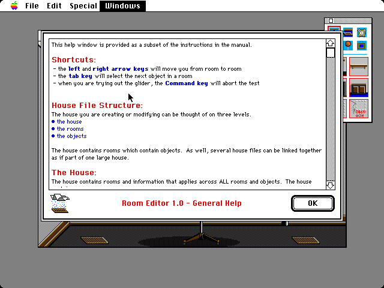
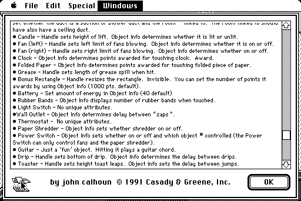
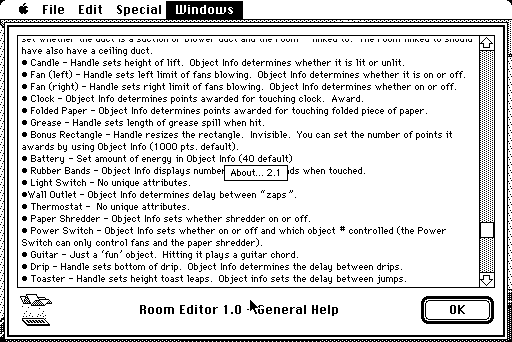
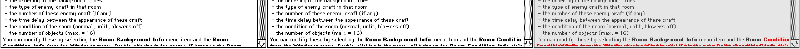

# The help window

The Room Editor's help window, Jon Wind's About™ 2.1 library, written from its disassembly, with the styled TextEdit, bold text, and Geneva 12 it needed. The pictures are the oracle's, which the port matches pixel for pixel in every screenshot of the case (`editorHelp`, `editorHelpColor`), but the comparison at the end, made before the last fix.

**01.** The help on a Mac II: the library's own layout, worked out from its code in pixels from the window's edges. The text in a frame inset 5 pixels, with the scroll bar overlapping its right edge; the icon 8 pixels in, the message in red Chicago 12 between it and OK, and OK's thick outline. The text is styled: Geneva 9, Geneva 9 bold in blue, and Geneva 12 bold in red, each line as tall as the tallest run on it. The Windows menu's title stays highlighted, as the editor opens the help before it lets go of the menu.

**02.** Held down, the icon becomes the click icon and the message the credit line; they go back when the button comes up. Before this, the text was scrolled by keys (the down arrow a line, ⌘ and the arrow a page) and by holding the scroll bar's page area, which pages until the thumb reaches the mouse; the port's TrackControl had called the scroll bar's action wherever in the control the mouse was.

**03.** An Option-click shows the library's version in a box, which the window's next update erases once the button comes up.

**04.** The one difference left at the first comparison, twice the Mac's pixels, from left to right the original, the port, and the difference in red: the port kept "Room Condition Info" on a line 487 pixels wide in a 455-pixel view, so the lines after it began differently. The change that was to measure line breaks run by run, in each run's face, had not been made: the script's text did not match the file's indentation, and it did not check that it had replaced anything.

