# Gamepads and touch screens

Two control methods the port adds to Glider, in its Controls submenu after Joystick: Gamepad, the browser's (the Gamepad API), and Virtual Gamepad, five buttons the page draws beside the Mac's screen. A finger on the screen is the mouse. These are the port's own, with nothing in the oracle to match; the pictures are of the built page in Chromium, emulating a phone (844 by 390 CSS pixels, 3 device pixels to one) or a desktop with a stand-in gamepad, and of the port's dialogs.

**01.** A phone held sideways, on the Mac Plus. The arrows on the left, energy and band on the right, pause above them, all in the margins: the screen still gets its 3 device pixels to a Mac pixel. The buttons' faces are Glider's own icons from its Configure dialog ('ICON' 980 to 983); pause has two bars drawn for it. The Virtual Gamepad is chosen for a touch screen the first time Glider starts. Before the menus are made it shows nothing, so the "New keyboard" alert of the first start is tapped away without it.

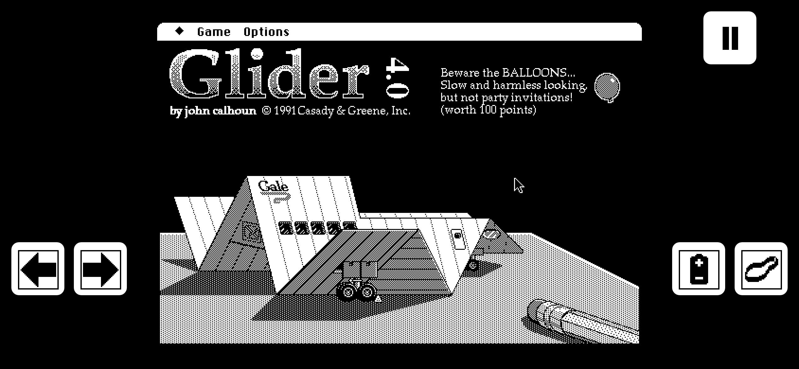

**02.** Upright, the buttons go below the screen, pause centered under them, and the screen centers in what is left. Integer scaling gives a Mac Plus 2 device pixels a pixel here, a Mac II only 1.

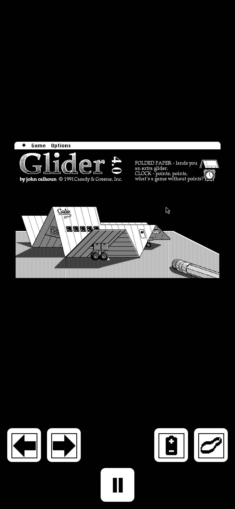

**03.** A finger pressed on Game and dragged down: the menu tracks as with a mouse held down, and lifting the finger on New Game chooses it.

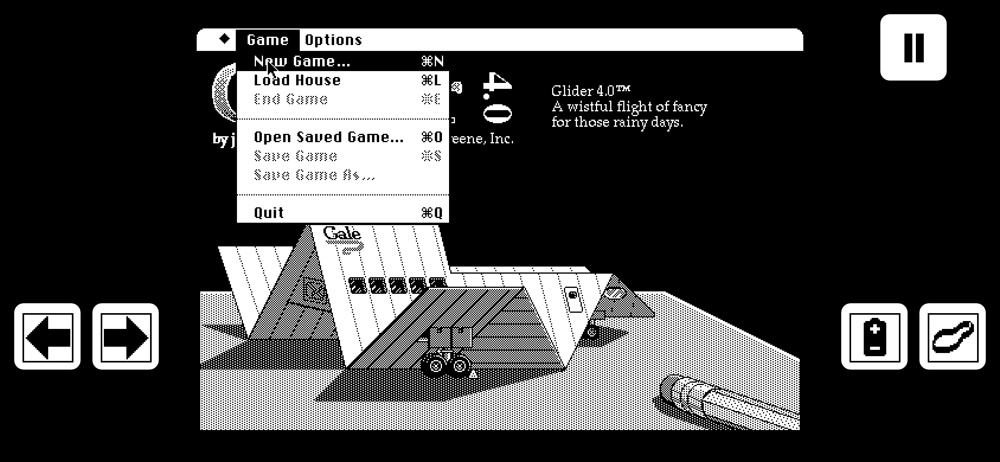

**04.** Two fingers at once, on right and energy: each is followed by its pointer ID, and a held button is inverted, as Configure inverts the icon clicked.

**05.** The pause button is the Tab key: Glider pauses and shows its menu bar, which reaches Save Game, End Game, and Quit.

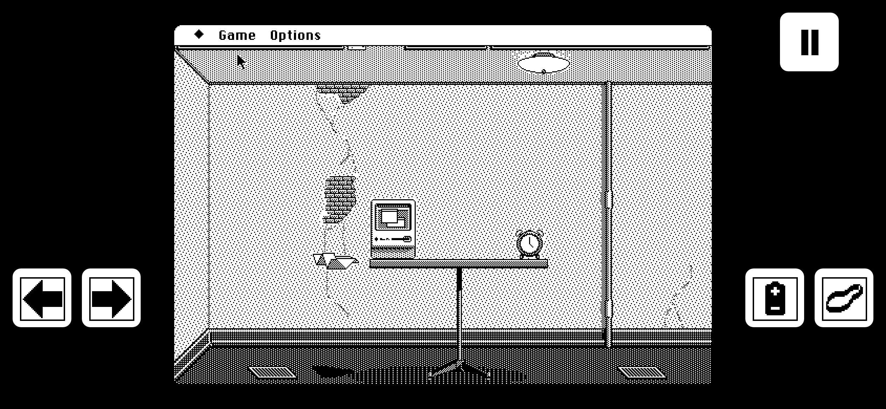

**06.** The Controls submenu on a Mac II: Joystick renamed "Joystick (Mouse)" for what it is, the mouse used as a joystick, and the two new items, colored as Joystick is. Without the page's host, as in the oracle cases, the submenu is the original's.

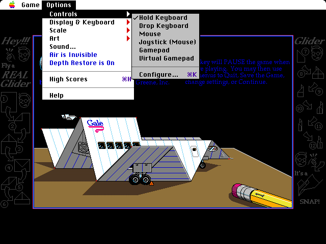

**07.** Configure, a row taller, with "Virtual Pad: { Arrows Left / Arrows Right }" under Mouse Button's group, made as that one is (a label, the brace 'PICT' 256, two radio buttons). "Virtual Gamepad:" did not fit the label's two lines, nor "Arrows Right" Mouse Button's radio buttons; the new ones run under the Okay button, where there is room.

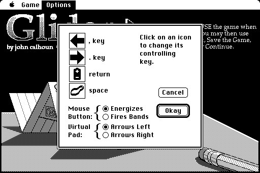

**08.** On a desktop with a mouse, Gamepad chosen: the virtual buttons stay hidden. With a stand-in gamepad on the standard mapping, the D-pad flew the glider at full thrust and Start paused the game.

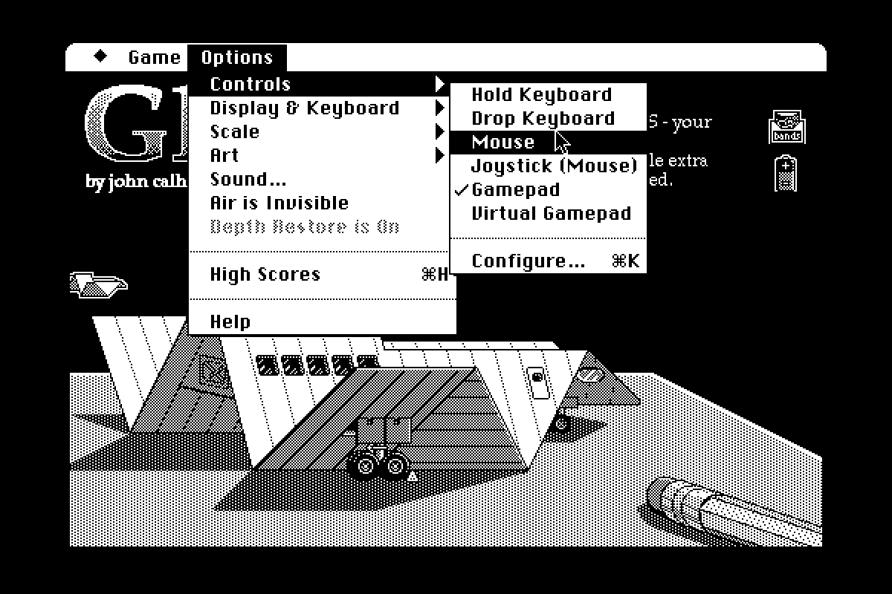

**09.** Later the same day, after playing on an Android phone and an iPad: an iPad held sideways (1194 by 770 CSS pixels, 2 device pixels to one), the Mac II at the largest size that fits, 1.41 CSS pixels to a Mac pixel, drawn sharp and shrunk smoothly; whole numbers of device pixels had given it 1. The arrows are apart: ← and band on the left, energy and → on the right, pause over energy. One finger holds ←; another is on the seam between energy and →, which presses both. A held button's rounded rectangle goes black around its icon, calmer than the whole button inverted.

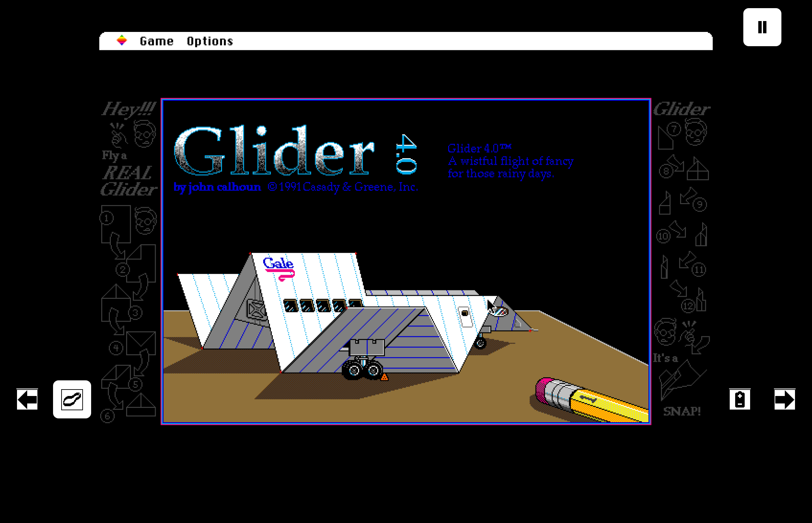

**10.** Configure with Arrows Apart. The brace, Glider's picture for two lines, is drawn taller in pieces, a row of each straight part repeated, so its curves keep their weight.

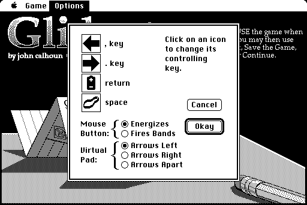

**11.** Looks to try, from Options > Look, on a Mac Plus at 4.5 device pixels to a Mac pixel, crops at full resolution. Sharp; Smooth, plain bilinear, soft everywhere; Soft (CRT), enlarged once across and fully down before the browser smooths it, so the title's dithered checks blend along each row while rows stay crisp (it shows best on a real screen, in motion); Sharp and Soft with scanlines; and Soft with all four touches: scanlines, glow, rounded corners (out of the crop), and a bluish phosphor tint.

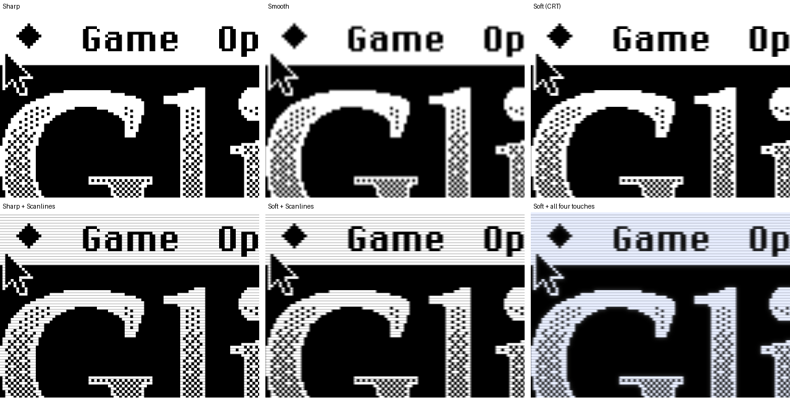

**12.** The same on a Mac II, at 3.2 device pixels to a Mac pixel, fractional: the menu bar's Chicago and the window's colored frame.

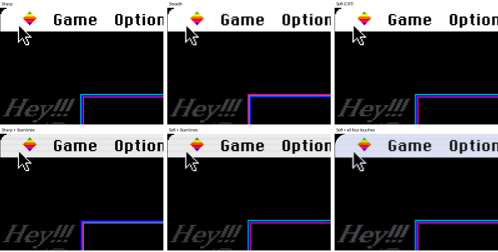

**13.** The Look submenu: one way to enlarge, checked, then the touches, each checked when on.

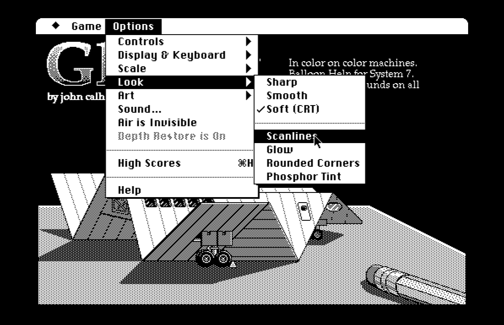

**14.** Mac Gamma on the Mac II in color, at 1 device pixel to a CSS pixel: the same title screen without it and with it. The midtones are lighter, as the Mac's own display (a gamma of about 1.8) showed them on a screen of today (2.2): 128 gray becomes 145, the floor's brown (144, 113, 58) becomes (159, 131, 75). Black and white stay as they are. (Paper gliders fly across the title screen, so the two differ where one is.)

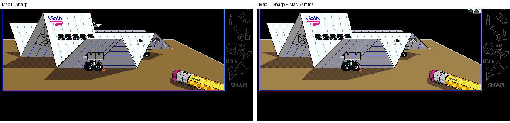

