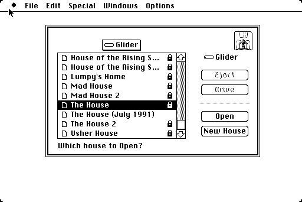
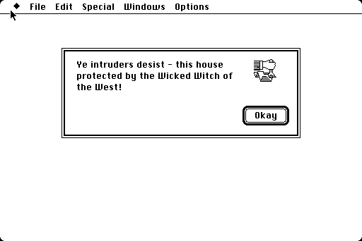
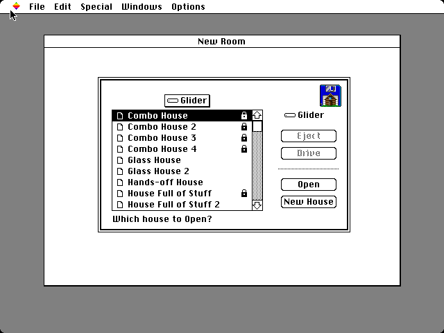

# Locked houses in the Room Editor

The Room Editor will not open a house locked with House Info's Lock House, and says so only when you try. The port's additions mark locked houses in its Open dialog with a padlock at the right end of the row, so you can see which ones before trying. The pictures are of the port on the page; the padlock is the port's own, as System 6 has none, and the oracle's cases, which run without the additions, show the original list.

**01.** The Open dialog on a Mac Plus, as the editor starts. The Combo Houses and House Full of Stuff are locked; the Glass Houses, Hands-off House, and House Full of Stuff 2 are not. The padlock is a 16-by-16 small icon in the style of Standard File's own, 3 pixels in from the right as the document icon is from the left, with a solid body to read at that size.

**02.** "The House" typed to select it: locked rows stay selectable, and the padlock inverts with the row. Long names end before the padlock with Standard File's ellipsis ("House of the Rising S…").

**03.** Opening it anyway gives the editor's own answer, as it always did.

**04.** The same on a Mac II, the selected row's padlock white on black.

