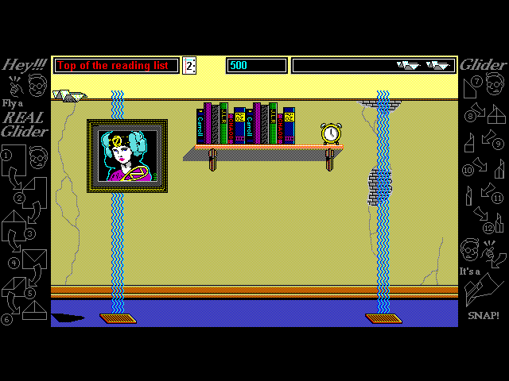
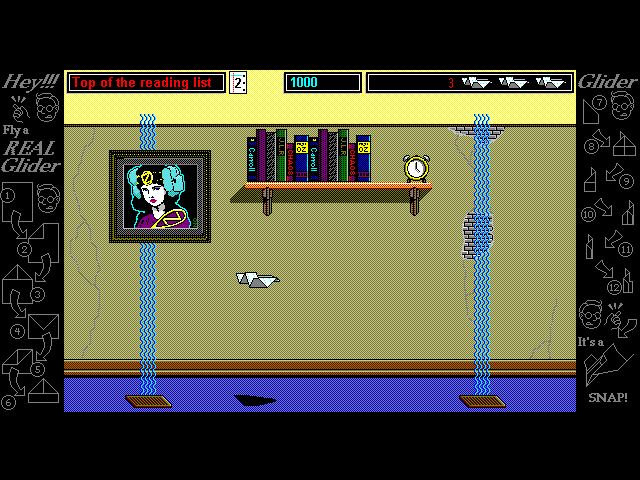
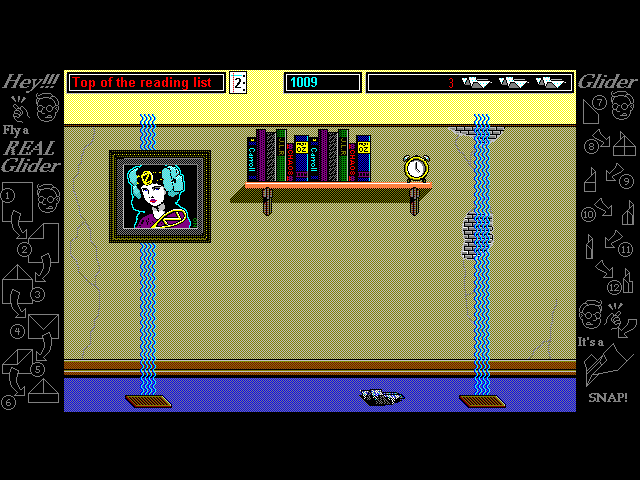
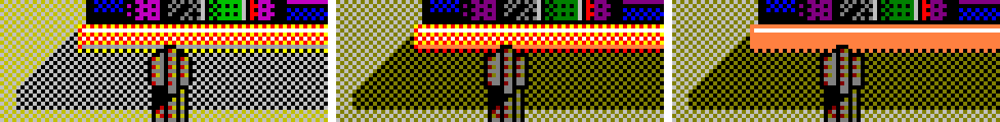

# Glider for Windows' colors, three ways

[All galleries](../)

Glider for Windows ("Glider/WIN 4.01", the 1995 CD) run in [v86](https://copy.sh/v86/), the in-browser PC emulator, on copy.sh's Windows 3.1 and Windows 98 disk images, to learn what its colors were in 256 colors and in True Color. The port's 256-color Windows look had been measured from DOSBox screenshots that show only two of the six dark colors. The same room is shown each way: The House's second room, "Top of the reading list", whose books are purple and green. The pictures are the emulator's screen cropped to Glider's 640×480; in 256 colors v86 expands the DAC's 6-bit levels a unit or two differently from DOSBox (level 48 shows as 192, not 195), so the colors were read from the DAC itself. [`docs/versions.md`](../../versions.md) ("Displays") has the findings.

**01.** Windows 3.1 at 256 colors, with its "Generic SuperVGA" driver. The wall's olive, the frame's dark red, and the books' purple and green are all brightened to 0xC0: the driver loads the six dark static colors so, before Glider runs. This is what the port's "Windows, 256 Colors" shows.

**02.** Windows 98 at 256 colors (a VESA driver). The static colors are the standard ones, darks at 0x80, so the room is darker: it looks like the port's "Windows, 16 Colors", but for the shelf's highlight (picture 04).

**03.** Windows 98 in True Color. The bitmaps keep their own colors, darks at 0x80, and nothing Glider draws in code is dithered: the shelf is solid light brown.

**04.** The shelf's left end, five times larger, in the same order. Light brown fills dither red, white and yellow in both 256-color runs and are solid (255, 128, 64) in True Color. The highlight under the shelf is Windows' static gray in Windows 3.1, (255, 127, 63) from the desktop's palette in Windows 98, and the fill's own color in True Color. The shadow's checkerboard is a pixel apart between the first two: its phase follows the window's place on the screen (1024×768 and 800×600 here), while the fills keep theirs with the play area.

