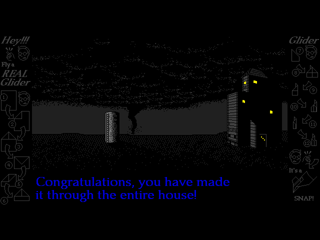
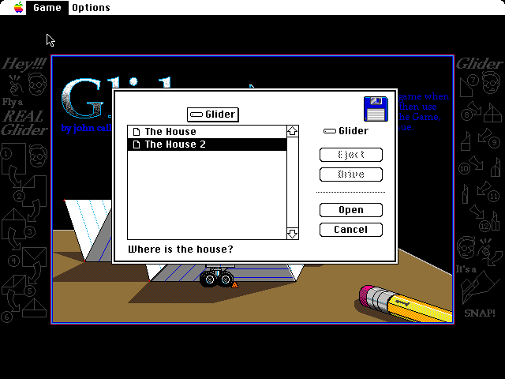
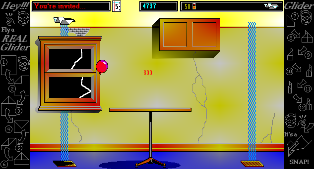

# How the port was made, in pictures

This port of Glider 4 is checked against the original: Glider 4 running on an emulated Mac Plus and Mac II (Mini vMac, made to run headless and to repeat exactly), with the same keys pressed at the same moments.
The two must agree pixel for pixel, tick for tick (a tick is a sixtieth of a second, the Mac's clock), and for sound sample for sample.
These galleries are the screenshots looked at along the way, kept with the bugs they showed.
[`PORT.md`](../../PORT.md), at the repository's root, tells the same story in words, in its journal.

Most pictures are of one of two kinds:

- **Comparisons** from the tests, three panels side by side: the original, the port, and a gray copy with the pixels that differ in red.
- **Screens** of the original or the port alone.

Each gallery says how its pictures are laid out.

## The galleries

**[Pictures, the oracle, and the first games](2026-10-17-pictures-oracle-and-first-games/)**, 17 and 18 October 2026: reading Glider's art, building the emulator "oracle" and measuring the Mac's QuickDraw with test pictures, recreating System 6's menus and dialogs, and the first games against the original, through a minute of random play.

**[Rooms and dialogs](2026-10-18-rooms-and-dialogs/)**, 18 October 2026: games started in other rooms, test rooms of chosen objects, how the Mac II draws patterns and colorizes, and Glider's dialogs in color.

**[Sound, the end of a house, and saved games](2026-10-19-sound-endings-and-saved-games/)**, 18 and 19 October 2026: keys racing the program within a tick, the browser's storage and icon, finishing a house, and saving a game.

**[Standard File on the Mac's screen](2026-10-19-standard-file/)**, 19 October 2026: System 6's file dialogs, read from its code and drawn by the port, and two errors in drawing gray that had cancelled out.

**[The desktop](2026-10-19-desktop/)**, 19 October 2026: MiniFinder tried and dropped, System 6.0.8's Finder measured, and the port's desktop, where quitting Glider goes.

**[Glider for Windows](windows/)**: the 1994 Windows release, for the port's planned Windows look.

