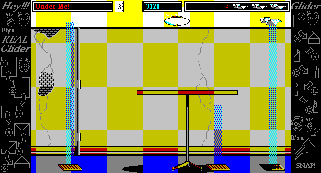
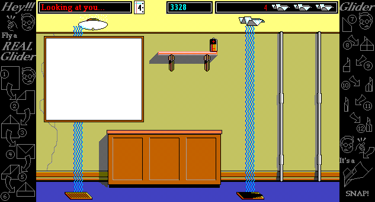
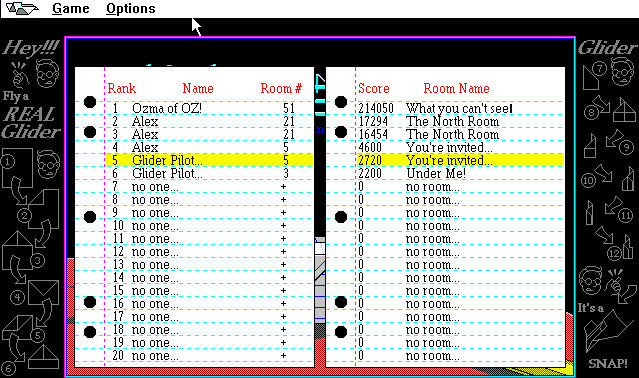
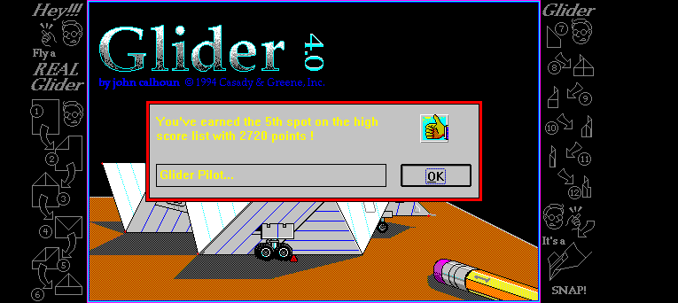
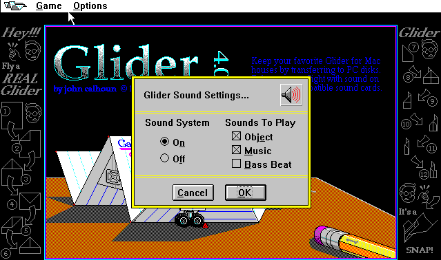

# Glider for Windows

[All galleries](../)

Screenshots of Glider for Windows ("Glider/WIN 4.01", 1994), the release the port's "Windows look" will follow: its palette now, its art later.
They were captured from the archive.org in-browser emulator (DOSBox running Windows 3.1), which runs Windows in 256 colors; [`docs/versions.md`](../../versions.md) describes the release and what these show about its palette.

Click a picture to see it at full size.

**The House, room 3**, with the air over the vents visible.

**Room 4:** a mirror, a shelf, a cabinet and a battery.

**Room 5:** a window with lightning, a balloon, and a floating score.

**The high scores**, in the Mac's layout with another font.

**Name entry for a new high score**, a dialog of the Windows version's own.

**Sound Settings.** Windows splits the Mac's Music setting in two: "Music" for the jingle on entering a room and "Bass Beat" for the bass during play. Bass Beat is off unless the player turns it on; the port will add the checkbox on by default, as the Mac plays the bass.

